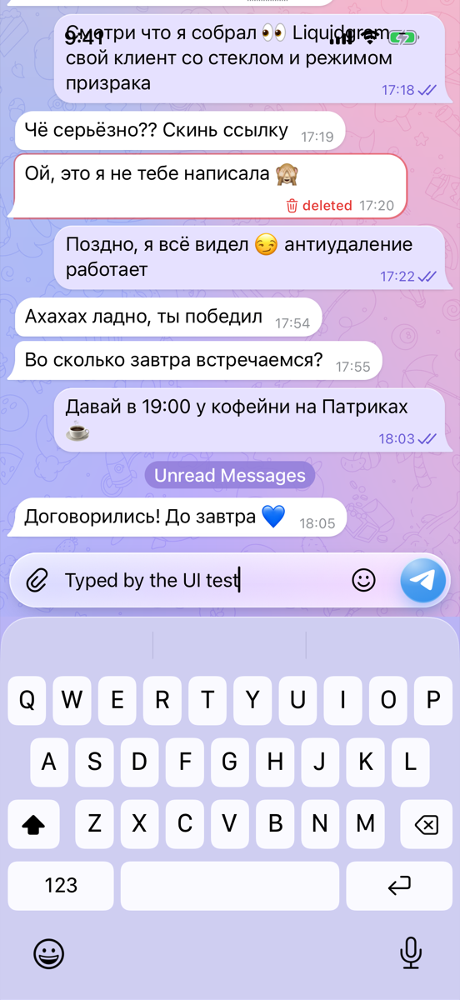
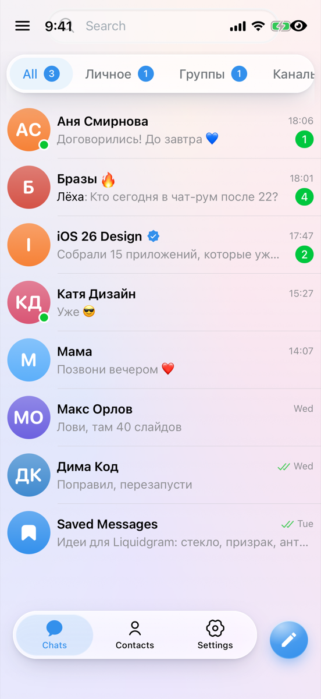
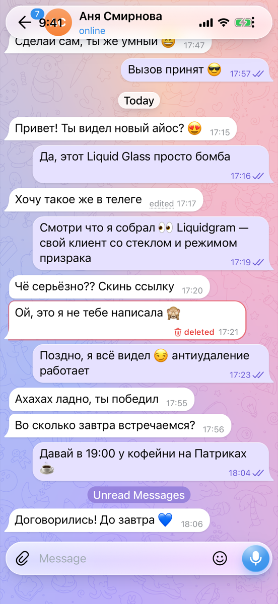

# Liquidgram UI tests

**Failed**: 9 passed, 2 failed, 0 skipped.

- Device: iPhone 17 Pro, iOS 26.2
- Branch: `ios-v2/fix-layout-web` at `0628fab`
- Run: https://github.com/levaasd142-cmd/liquidgram/actions/runs/40926755823
- Generated: 2026-10-29T18:08:31.938Z

## Tests

| Test | Pass | Status | Duration | Failure |
| --- | --- | --- | --- | --- |
| `CoreTests/testColdStartShowsApiKeysScreen` | light | Passed | 14.2 s |  |
| `CoreTests/testDemoAccount` | light | Passed | 15.9 s |  |
| `CoreTests/testDemoAccountSurvivesRestart` | light | Passed | 19.4 s |  |
| `CoreTests/testKeyboardKeepsFocusedFieldVisible` | light | Passed | 7.0 s |  |
| `CoreTests/testWebAppSelfTest` | light | Passed | 9.7 s |  |
| `FeatureTests/testChatHeaderStaysVisibleWhileTyping` | light | Failed | 11.0 s | FeatureTests.swift:286: XCTAssertTrue failed - The chat header (114.0, -324.0, 121.0, 24.0) left the screen while typing; the status bar ends at y 54.0 |
| `FeatureTests/testDeepLinkOpensSettings` | light | Passed | 11.1 s |  |
| `FeatureTests/testHeadersStayBelowStatusBar` | light | Failed | 7.6 s | FeatureTests.swift:267: XCTAssertTrue failed - Under the status bar, which ends at y 54.0: the chat list header starts at y 12.0; the chat header starts at y 11.0 |
| `FeatureTests/testKeyboardHasNoFormToolbar` | light | Passed | 6.3 s |  |
| `FeatureTests/testLiquidgramSettingsShowIPhoneSection` | light | Passed | 11.2 s |  |
| `CoreTests/testDemoAccount` | dark | Passed | 20.8 s |  |

## Self-test (light)

| Check | Result | Detail |
| --- | --- | --- |
| `bridge` | ok | version 1.0.0, notification permission default |
| `notificationBridge` | ok | permission default |
| `noServiceWorker` | ok | service workers are unavailable |
| `secureContext` | ok | http://127.0.0.1:47821 |
| `webCrypto` | ok | SHA-256 digest matches |
| `localStorage` | ok | write, read and remove work |
| `indexedDb` | ok | open, put and get work |
| `webAssembly` | ok | a module compiles and runs |
| `worker` | ok | a module worker from the app's origin answered (secure context true) |
| `fetchIndex` | ok | status 200, text/html; charset=utf-8 |
| `rangeRequest` | ok | /assets/index-B6X3G-tw.js: 206 with bytes 100-1123/101631 |
| `userAgentMobile` | ok | Mozilla/5.0 (iPhone; CPU iPhone OS 18_7 like Mac OS X) AppleWebKit/605.1.15 (KHTML, like Gecko) Mobile/15E148 Liquidgram |
| `userAgentLiquidgram` | ok | Mozilla/5.0 (iPhone; CPU iPhone OS 18_7 like Mac OS X) AppleWebKit/605.1.15 (KHTML, like Gecko) Mobile/15E148 Liquidgram |
| `appRendered` | ok | Transition full-height is-auth |
| `compatTest` | ok | passed |
| `noPageErrors` | ok | none since the page started |

<details><summary>Page details</summary>

```json
{
  "url": "http://127.0.0.1:47821/",
  "userAgent": "Mozilla/5.0 (iPhone; CPU iPhone OS 18_7 like Mac OS X) AppleWebKit/605.1.15 (KHTML, like Gecko) Mobile/15E148 Liquidgram",
  "language": "en-US",
  "viewport": "402x874 at 3x",
  "colorScheme": "light",
  "backdropFilter": true,
  "blobWorker": "blocked: Error: worker error: the script did not load",
  "authScreen": true
}
```

</details>

Folders: [`screenshots/`](screenshots), [`ax/`](ax) (accessibility trees the tests attached), [`logs/`](logs) (app log, xcodebuild output, self-test reports).

## Screenshots

### `CoreTests/testColdStartShowsApiKeysScreen (light)`


[01-api-keys-screen](screenshots/CoreTests-testColdStartShowsApiKeysScreen-01-api-keys-screen.png)

### `CoreTests/testDemoAccount (light)`


[01-chat-list](screenshots/CoreTests-testDemoAccount-01-chat-list.png) · [02-chat](screenshots/CoreTests-testDemoAccount-02-chat.png) · [03-composer-with-keyboard](screenshots/CoreTests-testDemoAccount-03-composer-with-keyboard.png)

### `CoreTests/testDemoAccountSurvivesRestart (light)`


[01-chat-list-before-restart](screenshots/CoreTests-testDemoAccountSurvivesRestart-01-chat-list-before-restart.png) · [02-chat-list-after-restart](screenshots/CoreTests-testDemoAccountSurvivesRestart-02-chat-list-after-restart.png)

### `CoreTests/testKeyboardKeepsFocusedFieldVisible (light)`


[01-keyboard-up](screenshots/CoreTests-testKeyboardKeepsFocusedFieldVisible-01-keyboard-up.png)

### `CoreTests/testWebAppSelfTest (light)`


[01-self-test-finished](screenshots/CoreTests-testWebAppSelfTest-01-self-test-finished.png)

### `FeatureTests/testChatHeaderStaysVisibleWhileTyping (light)`



[01-typing](screenshots/FeatureTests-testChatHeaderStaysVisibleWhileTyping-01-typing.png)

### `FeatureTests/testDeepLinkOpensSettings (light)`


[01-settings-from-deep-link](screenshots/FeatureTests-testDeepLinkOpensSettings-01-settings-from-deep-link.png)

### `FeatureTests/testHeadersStayBelowStatusBar (light)`




[01-chat-list-header](screenshots/FeatureTests-testHeadersStayBelowStatusBar-01-chat-list-header.png) · [02-chat-header](screenshots/FeatureTests-testHeadersStayBelowStatusBar-02-chat-header.png)

### `FeatureTests/testKeyboardHasNoFormToolbar (light)`


[01-keyboard](screenshots/FeatureTests-testKeyboardHasNoFormToolbar-01-keyboard.png)

### `FeatureTests/testLiquidgramSettingsShowIPhoneSection (light)`


[01-liquidgram-settings](screenshots/FeatureTests-testLiquidgramSettingsShowIPhoneSection-01-liquidgram-settings.png) · [02-iphone-section](screenshots/FeatureTests-testLiquidgramSettingsShowIPhoneSection-02-iphone-section.png)

### `CoreTests/testDemoAccount (dark)`


[01-chat-list-dark](screenshots/CoreTests-testDemoAccount-01-chat-list-dark.png) · [02-chat-dark](screenshots/CoreTests-testDemoAccount-02-chat-dark.png) · [03-composer-with-keyboard-dark](screenshots/CoreTests-testDemoAccount-03-composer-with-keyboard-dark.png)

