# Liquidgram UI tests

**Failed**: 42 passed, 4 failed, 1 skipped.

- Device: iPhone 17 Pro, iOS 26.2
- Branch: `ios-v2/integration2` at `f751fdd`
- Run: https://github.com/levaasd142-cmd/liquidgram/actions/runs/40937116355
- Generated: 2026-10-29T19:38:39.611Z

## Tests

| Test | Pass | Status | Duration | Failure |
| --- | --- | --- | --- | --- |
| `CoreTests/testColdStartShowsApiKeysScreen` | light | Passed | 50.8 s |  |
| `CoreTests/testDemoAccount` | light | Failed | 51.8 s | CoreTests.swift:118: failed - Not found within 20 s: a message of the opened chat |
| `CoreTests/testDemoAccountSurvivesRestart` | light | Passed | 51.4 s |  |
| `CoreTests/testKeyboardKeepsFocusedFieldVisible` | light | Passed | 14.4 s |  |
| `CoreTests/testWebAppSelfTest` | light | Passed | 14.0 s |  |
| `FeatureTests/testAppLockOpensAndLocksAgainAfterBackground` | light | Passed | 26.4 s |  |
| `FeatureTests/testAppLockStaysLockedWhenAuthenticationFails` | light | Passed | 17.7 s |  |
| `FeatureTests/testDeepLinkOpensSettings` | light | Passed | 21.6 s |  |
| `FeatureTests/testKeyboardHasNoFormToolbar` | light | Passed | 10.0 s |  |
| `FeatureTests/testLiquidgramSettingsShowIPhoneSection` | light | Passed | 16.0 s |  |
| `FeatureTests/testPrivacyShieldCoversAppWhileInactive` | light | Passed | 23.7 s |  |
| `FeatureTests/testQuickActionFocusesSearch` | light | Passed | 18.9 s |  |
| `FeatureTests/testQuickActionOpensNewMessage` | light | Passed | 21.7 s |  |
| `FeatureTests/testQuickActionOpensSavedMessages` | light | Passed | 11.3 s |  |
| `FeatureTests/testQuickActionTogglesGhostMode` | light | Passed | 8.8 s |  |
| `GestureTests/testChatListRightSwipeKeepsChatList` | light | Passed | 15.7 s |  |
| `GestureTests/testLongPressOpensMessageMenu` | light | Passed | 23.3 s |  |
| `GestureTests/testSlowShortSwipeSpringsBack` | light | Passed | 23.1 s |  |
| `GestureTests/testSwipeBackClosesProfile` | light | Passed | 19.5 s |  |
| `GestureTests/testSwipeBackFromEdgeClosesChat` | light | Passed | 16.6 s |  |
| `GestureTests/testSwipeBackFromMiddleClosesChat` | light | Passed | 16.1 s |  |
| `GestureTests/testSwipeToReply` | light | Passed | 15.9 s |  |
| `RecordingTests/testHoldRecordsVoiceAndSlidesCancelOrLock` | light | Passed | 25.1 s |  |
| `RecordingTests/testTapSwitchesBetweenVoiceAndVideo` | light | Passed | 18.9 s |  |
| `RoundVideoTests/testCancelDiscardsRecording` | light | Passed | 20.9 s |  |
| `RoundVideoTests/testRecorderExplainsMissingCamera` | light | Passed | 19.9 s |  |
| `RoundVideoTests/testRecordsAndSendsRoundVideo` | light | Passed | 28.9 s |  |
| `ShellTests/testIPhoneStaysInPortrait` | light | Passed | 11.1 s |  |
| `ShellTests/testKeyboardResizesPageAndRestoresIt` | light | Passed | 22.5 s |  |
| `ShellTests/testWindowOpenedLateShowsInAppBrowser` | light | Failed | 14.5 s | ShellTests.swift:154: Failed to determine hittability of "Open a page later" Button: Activation point invalid and no suggested hit points based on element frame |
| `TransportTests/testLegacyDataMovesToAppOrigin` | light | Skipped | 0.8 s | Test skipped - Needs the data of the loopback version; run-ui-tests.sh seeds it with UI_TESTS_LEGACY_REF |
| `TransportTests/testMediaStreamsFromPage` | light | Passed | 19.6 s |  |
| `UsabilityTests/testAppStaysPortrait` | light | Passed | 13.2 s |  |
| `UsabilityTests/testAttachMenuAndEmojiPanelFitOnScreen` | light | Passed | 34.9 s |  |
| `UsabilityTests/testChatListTopRowWorks` | light | Passed | 56.4 s |  |
| `UsabilityTests/testChatTopRowWorks` | light | Failed | 19.8 s | UsabilityTests.swift:817: Failed to determine hittability of "Select messages" MenuItem: Activation point invalid and no suggested hit points based on element frame |
| `UsabilityTests/testDelayedWindowOpenShowsInAppBrowser` | light | Passed | 46.1 s |  |
| `UsabilityTests/testDraggingMessagesHidesKeyboard` | light | Passed | 41.0 s |  |
| `UsabilityTests/testKeyboardKeepsChatLayout` | light | Failed | 53.7 s | UsabilityTests.swift:443: failed - The chat with the keyboard: The page scrolled during the keyboard cycles: highest pageTop 0.0, offsetTop 335.0, scrollTop 0.0, scrollY 0.0 |
| `UsabilityTests/testLongPressOnMessageOpensMenu` | light | Passed | 29.3 s |  |
| `UsabilityTests/testMediaViewerOpensAndCloses` | light | Passed | 34.8 s |  |
| `UsabilityTests/testPageIsActiveBeforeFirstTap` | light | Passed | 16.5 s |  |
| `UsabilityTests/testProfileTopRowWorks` | light | Passed | 28.3 s |  |
| `UsabilityTests/testSettingsTopRowWorks` | light | Passed | 23.1 s |  |
| `UsabilityTests/testStatusBarStripMatchesTheme` | light | Passed | 34.7 s |  |
| `CoreTests/testDemoAccount` | dark | Passed | 54.9 s |  |
| `UsabilityTests/testStatusBarStripMatchesTheme` | dark | Passed | 13.5 s |  |

## Self-test (light)

| Check | Result | Detail |
| --- | --- | --- |
| `bridge` | ok | version 1.0.0, notification permission default |
| `notificationBridge` | ok | permission default |
| `noServiceWorker` | ok | service workers are unavailable |
| `appOrigin` | ok | liquidgram-web://app |
| `secureContext` | ok | liquidgram-web://app |
| `webCrypto` | ok | SHA-256 digest matches |
| `localStorage` | ok | write, read and remove work |
| `indexedDb` | ok | open, put and get work |
| `webAssembly` | ok | a module compiles and runs |
| `worker` | ok | a module worker from the app's origin answered (secure context true) |
| `fetchIndex` | ok | status 200, text/html; charset=utf-8 |
| `rangeRequest` | ok | /assets/index-Cjmo11nt.js: 206 with bytes 100-1123/101631 |
| `userAgentMobile` | ok | Mozilla/5.0 (iPhone; CPU iPhone OS 18_7 like Mac OS X) AppleWebKit/605.1.15 (KHTML, like Gecko) Mobile/15E148 Liquidgram |
| `userAgentLiquidgram` | ok | Mozilla/5.0 (iPhone; CPU iPhone OS 18_7 like Mac OS X) AppleWebKit/605.1.15 (KHTML, like Gecko) Mobile/15E148 Liquidgram |
| `appRendered` | ok | Transition full-height is-auth |
| `compatTest` | ok | passed |
| `noPageErrors` | ok | none since the page started |

<details><summary>Page details</summary>

```json
{
  "url": "liquidgram-web://app/",
  "userAgent": "Mozilla/5.0 (iPhone; CPU iPhone OS 18_7 like Mac OS X) AppleWebKit/605.1.15 (KHTML, like Gecko) Mobile/15E148 Liquidgram",
  "language": "en-US",
  "viewport": "402x812 at 3x",
  "colorScheme": "light",
  "backdropFilter": true,
  "blobWorker": "blocked: Error: worker error: the script did not load",
  "authScreen": true
}
```

</details>

## Self-test (light)

| Check | Result | Detail |
| --- | --- | --- |
| `roundVideoCancelResult` | ok | null |
| `roundVideoCancelEvents` | ok | presented, cancelled |
| `roundVideoCancelFiles` | ok | 0 files stored |

<details><summary>Page details</summary>

```json
{
  "app": {
    "events": [
      "presented",
      "cancelled"
    ],
    "storedFiles": 0
  },
  "page": {
    "hasRecorder": true,
    "origin": "liquidgram-web://app",
    "pageErrors": [],
    "result": null,
    "secondRequest": null
  }
}
```

</details>

## Self-test (light)

| Check | Result | Detail |
| --- | --- | --- |
| `roundVideoNoCameraResult` | ok | null |

<details><summary>Page details</summary>

```json
{
  "app": {},
  "page": {
    "hasRecorder": true,
    "origin": "liquidgram-web://app",
    "pageErrors": [],
    "result": null,
    "secondRequest": null
  }
}
```

</details>

## Self-test (light)

| Check | Result | Detail |
| --- | --- | --- |
| `roundVideoBridge` | ok | liquidgram-web://app |
| `roundVideoSecondRequest` | ok | a second request while recording got null |
| `roundVideoPath` | ok | /__liquidgram/media/6ca8a2b337ad20c25600b631ee712ac0.mp4 |
| `roundVideoSize` | ok | 480x480 |
| `roundVideoResultDuration` | ok | 13733 ms |
| `roundVideoViewOnce` | ok | true |
| `roundVideoPageErrors` | ok | [] |
| `roundVideoFastStart` | ok | ftyp, moov, mdat |
| `roundVideoVideoTrack` | ok | avc1 480x480 |
| `roundVideoH264High` | ok | profile 100, level 30, CABAC true |
| `roundVideoAudioTrack` | ok | mp4a object type 2, 48000 Hz, 1 channel, 64000 bit/s |
| `roundVideoDuration` | ok | file 13733 ms, page 13733 ms, recorded 13733 ms |
| `roundVideoFrames` | ok | 412 frames in 13.733 s |
| `roundVideoFileSize` | ok | 913617 bytes |
| `roundVideoDecodes` | ok | 480x480 |
| `roundVideoPageFetch` | ok | {"blobType":"video\/mp4","contentType":"video\/mp4","size":913617,"status":200,"topLevelBoxes":["ftyp","moov","mdat"],"video":{"durationMs":13733,"height":480,"width":480}} |
| `roundVideoPageDecode` | ok | {"durationMs":13733,"height":480,"width":480} |
| `roundVideoPageRange` | ok | {"contentRange":"bytes 0-1\/913617","length":2,"status":206} |
| `roundVideoPageRelease` | ok | {"status":404} |
| `roundVideoEvents` | ok | presented, sent, released |
| `roundVideoReleased` | ok | 0 files stored after the release |

<details><summary>Page details</summary>

```json
{
  "app": {
    "events": [
      "presented",
      "sent",
      "released"
    ],
    "file": {
      "decodedFrame": "480x480",
      "durationMs": 13733,
      "fastStart": true,
      "recordedDurationMs": 13733,
      "size": 913617,
      "topLevelBoxes": [
        "ftyp",
        "moov",
        "mdat"
      ],
      "tracks": [
        {
          "cabac": true,
          "codec": "avc1",
          "durationMs": 13733,
          "handler": "vide",
          "height": 480,
          "level": 30,
          "profile": 100,
          "samples": 412,
          "width": 480
        },
        {
          "audioObjectType": 2,
          "averageBitRate": 64000,
          "channelConfiguration": 1,
          "channels": 2,
          "codec": "mp4a",
          "durationMs": 13781,
          "handler": "soun",
          "objectTypeIndication": 64,
          "sampleRate": 48000,
          "samples": 646,
          "samplingFrequencyIndex": 3
        }
      ]
    },
    "result": {
      "durationMs": 13733,
      "height": 480,
      "isViewOnce": true,
      "url": "/__liquidgram/media/6ca8a2b337ad20c25600b631ee712ac0.mp4",
      "width": 480
    },
    "storedFiles": 0
  },
  "page": {
    "afterRelease": {
      "status": 404
    },
    "fetch": {
      "blobType": "video/mp4",
      "contentType": "video/mp4",
      "size": 913617,
      "status": 200,
      "topLevelBoxes": [
        "ftyp",
        "moov",
        "mdat"
      ],
      "video": {
        "durationMs": 13733,
        "height": 480,
        "width": 480
      }
    },
    "hasRecorder": true,
    "origin": "liquidgram-web://app",
    "pageErrors": [],
    "range": {
      "contentRange": "bytes 0-1/913617",
      "length": 2,
      "status": 206
    },
    "result": {
      "durationMs": 13733,
      "height": 480,
      "isViewOnce": true,
      "url": "/__liquidgram/media/6ca8a2b337ad20c25600b631ee712ac0.mp4",
      "width": 480
    },
    "secondRequest": null
  }
}
```

</details>

## Self-test (light)

| Check | Result | Detail |
| --- | --- | --- |
| `appOrigin` | ok | liquidgram-web://app |
| `loadMediaPartRegistered` | ok | the web app set `window.__liquidgramNative.loadMediaPart` |
| `webAppChain` | ok | played in 1392 ms, seeked in 429 ms and played to 2.33 s of 3 s; the web app downloaded parts 0, 3 of 4 |
| `probeRange` | ok | 206 bytes 0-1, video/mp4, nosniff, sandbox |
| `openRange` | ok | 206 with the first 524288 bytes |
| `unalignedRanges` | ok | across a part boundary and at the end of the file |
| `suffixRanges` | ok | with and without the size in the URL |
| `beyondEnd` | ok | 416 with bytes */1300000 |
| `wholeFile` | ok | GET without a range is 200 with every part in order; HEAD gives the size |
| `parallelRanges` | ok | 12 requests, at most 4 parts loading at once |
| `contentTypeGuard` | ok | text/html is served as application/octet-stream in a sandbox |
| `failedPart` | ok | the request failed (TypeError: Load failed), the next one worked |
| `abortedFetch` | ok | a request stopped while streaming leaves the stream working |
| `audioStreamsAndSeeks` | ok | played in 1412 ms, seeked in 639 ms and played to 24.62 s of 30 s; 2 of 6 parts were in when it started |
| `videoPlaysAndSeeks` | ok | played in 674 ms, seeked in 370 ms and played to 2.38 s of 3 s; parts 0, 3 of 4 were asked for |

<details><summary>Page details</summary>

```json
{
  "migrationOutcome": "nothing to move",
  "webAppChain": {
    "playingMs": 1392,
    "duration": 3,
    "seekedMs": 429,
    "playedTo": 2.33,
    "parts": [
      0,
      3
    ]
  },
  "audio": {
    "playingMs": 1412,
    "partsBeforePlaying": 2,
    "duration": 30,
    "seekedMs": 639,
    "playedTo": 24.62,
    "requestedParts": [
      0,
      4,
      5
    ],
    "totalParts": 6,
    "seekPart": 4
  },
  "video": {
    "playingMs": 674,
    "partsBeforePlaying": 1,
    "duration": 3,
    "seekedMs": 370,
    "playedTo": 2.38,
    "requestedParts": [
      0,
      3
    ]
  }
}
```

</details>

Folders: [`screenshots/`](screenshots), [`ax/`](ax) (accessibility trees of failed tests), [`logs/`](logs) (app log, xcodebuild output, self-test reports).

## Screenshots

All screenshots at a glance, with a band for the test's result: green passed, red failed, orange the moment of the failure.

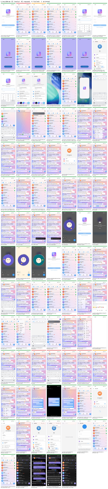

### `CoreTests/testColdStartShowsApiKeysScreen (light)`

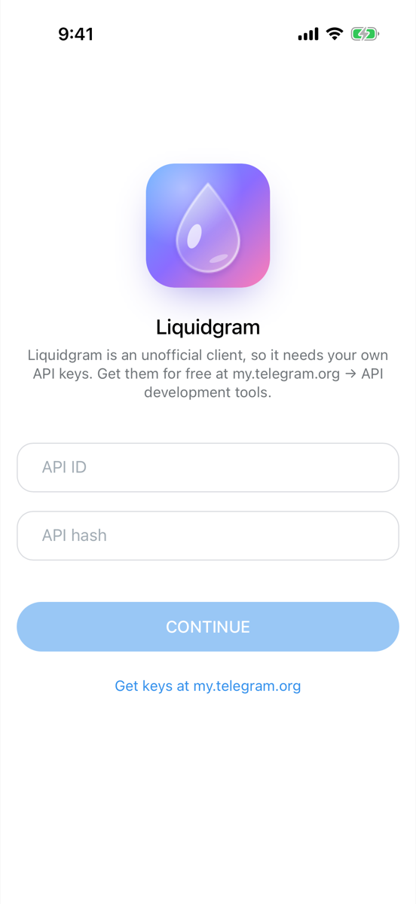

[01-api-keys-screen](screenshots/CoreTests-testColdStartShowsApiKeysScreen-01-api-keys-screen.png)

### `CoreTests/testDemoAccount (light)`

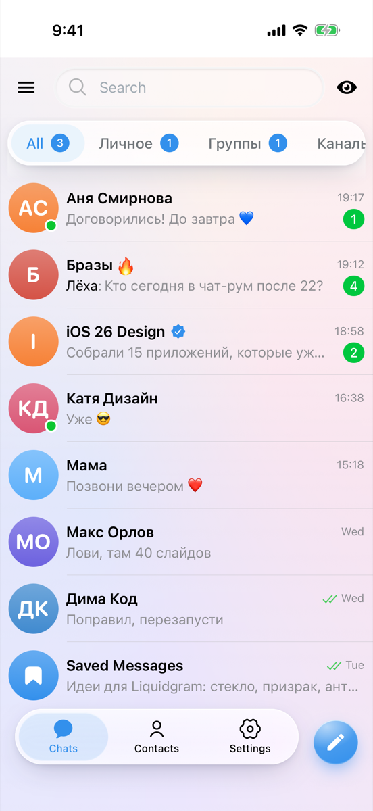
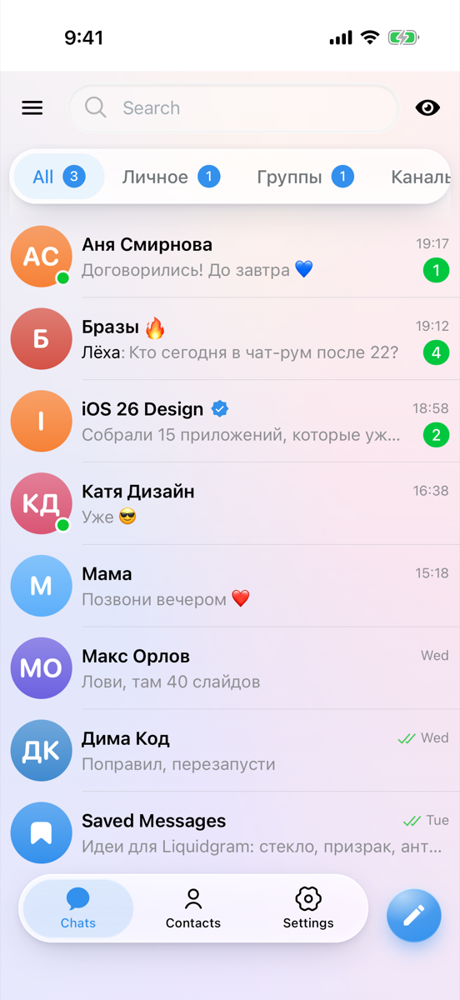

[01-chat-list](screenshots/CoreTests-testDemoAccount-01-chat-list.png) · [failure-a-message-of-the-opened-chat](screenshots/CoreTests-testDemoAccount-failure-a-message-of-the-opened-chat.png)

### `CoreTests/testDemoAccountSurvivesRestart (light)`

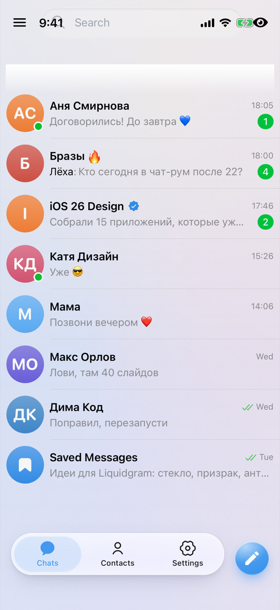
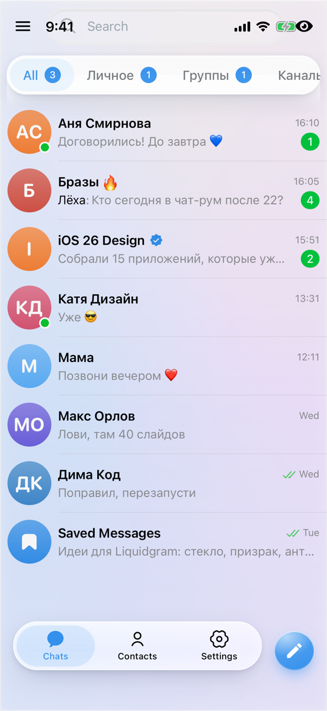

[01-chat-list-before-restart](screenshots/CoreTests-testDemoAccountSurvivesRestart-01-chat-list-before-restart.png) · [02-chat-list-after-restart](screenshots/CoreTests-testDemoAccountSurvivesRestart-02-chat-list-after-restart.png)

### `CoreTests/testKeyboardKeepsFocusedFieldVisible (light)`

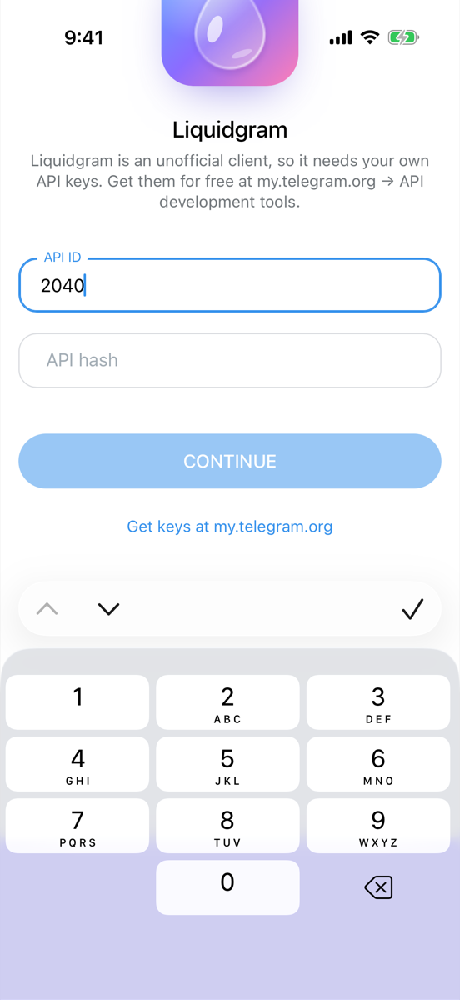

[01-keyboard-up](screenshots/CoreTests-testKeyboardKeepsFocusedFieldVisible-01-keyboard-up.png)

### `CoreTests/testWebAppSelfTest (light)`


[01-self-test-finished](screenshots/CoreTests-testWebAppSelfTest-01-self-test-finished.png)

### `FeatureTests/testAppLockOpensAndLocksAgainAfterBackground (light)`

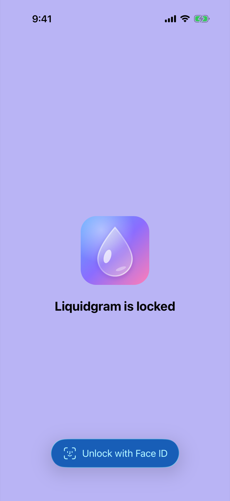


[01-locked-at-launch](screenshots/FeatureTests-testAppLockOpensAndLocksAgainAfterBackground-01-locked-at-launch.png) · [02-unlocked](screenshots/FeatureTests-testAppLockOpensAndLocksAgainAfterBackground-02-unlocked.png) · [03-locked-after-background](screenshots/FeatureTests-testAppLockOpensAndLocksAgainAfterBackground-03-locked-after-background.png) · [04-unlocked-again](screenshots/FeatureTests-testAppLockOpensAndLocksAgainAfterBackground-04-unlocked-again.png)

### `FeatureTests/testAppLockStaysLockedWhenAuthenticationFails (light)`


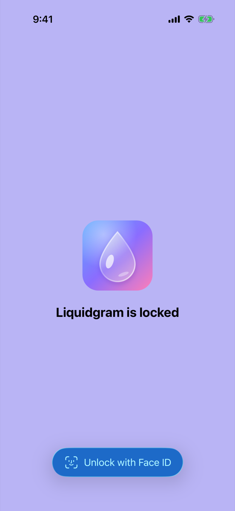

[01-failed-authentication](screenshots/FeatureTests-testAppLockStaysLockedWhenAuthenticationFails-01-failed-authentication.png) · [02-failed-again](screenshots/FeatureTests-testAppLockStaysLockedWhenAuthenticationFails-02-failed-again.png)

### `FeatureTests/testDeepLinkOpensSettings (light)`


[01-settings-from-deep-link](screenshots/FeatureTests-testDeepLinkOpensSettings-01-settings-from-deep-link.png)

### `FeatureTests/testKeyboardHasNoFormToolbar (light)`


[01-keyboard](screenshots/FeatureTests-testKeyboardHasNoFormToolbar-01-keyboard.png)

### `FeatureTests/testLiquidgramSettingsShowIPhoneSection (light)`


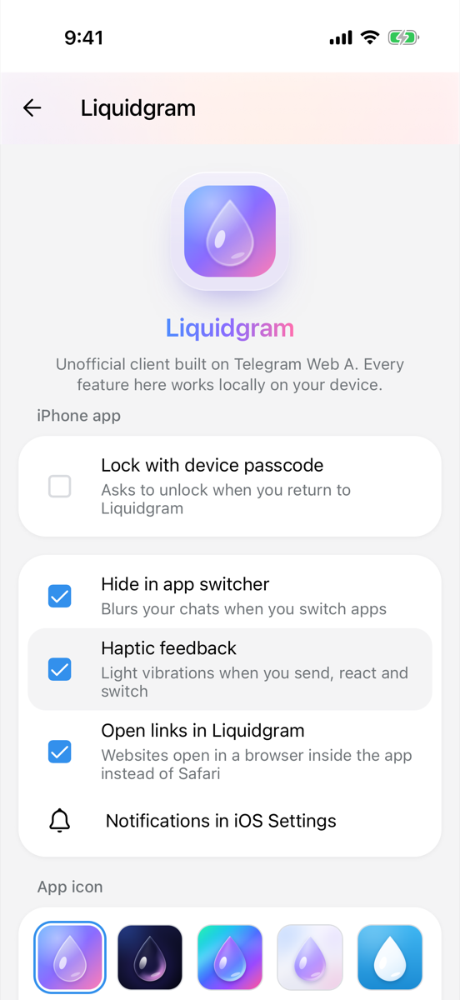

[01-liquidgram-settings](screenshots/FeatureTests-testLiquidgramSettingsShowIPhoneSection-01-liquidgram-settings.png) · [02-iphone-section](screenshots/FeatureTests-testLiquidgramSettingsShowIPhoneSection-02-iphone-section.png)

### `FeatureTests/testPrivacyShieldCoversAppWhileInactive (light)`


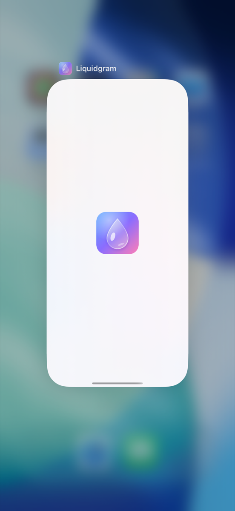

[01-shield-under-notification-center](screenshots/FeatureTests-testPrivacyShieldCoversAppWhileInactive-01-shield-under-notification-center.png) · [02-shield-removed](screenshots/FeatureTests-testPrivacyShieldCoversAppWhileInactive-02-shield-removed.png) · [03-app-switcher](screenshots/FeatureTests-testPrivacyShieldCoversAppWhileInactive-03-app-switcher.png)

### `FeatureTests/testQuickActionFocusesSearch (light)`

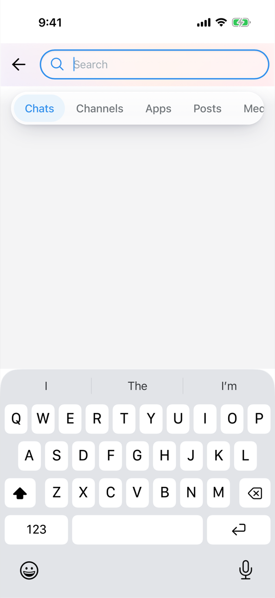

[01-search-focused](screenshots/FeatureTests-testQuickActionFocusesSearch-01-search-focused.png)

### `FeatureTests/testQuickActionOpensNewMessage (light)`

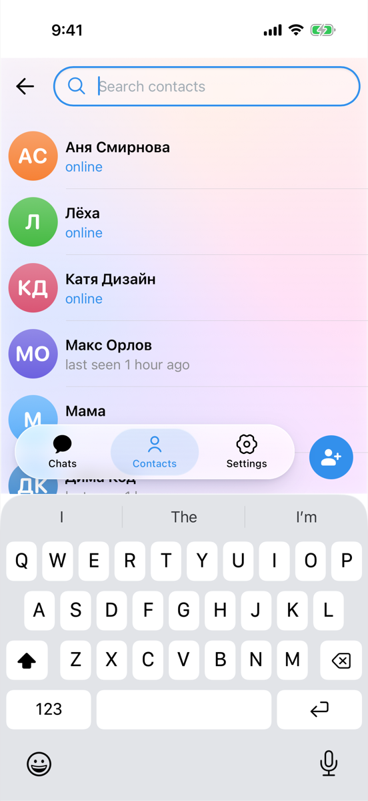

[01-new-message](screenshots/FeatureTests-testQuickActionOpensNewMessage-01-new-message.png)

### `FeatureTests/testQuickActionOpensSavedMessages (light)`

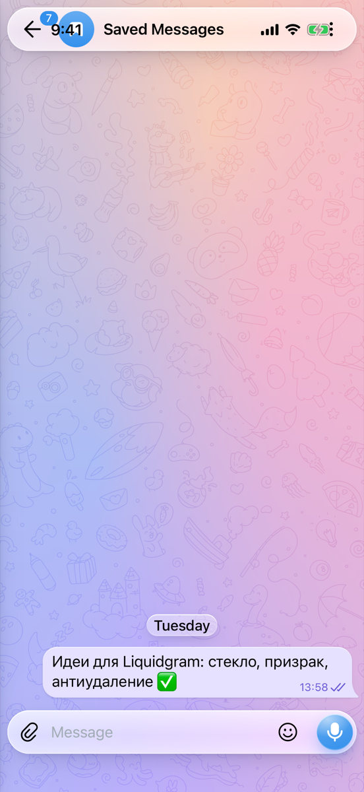

[01-saved-messages](screenshots/FeatureTests-testQuickActionOpensSavedMessages-01-saved-messages.png)

### `FeatureTests/testQuickActionTogglesGhostMode (light)`


[01-ghost-mode-toast](screenshots/FeatureTests-testQuickActionTogglesGhostMode-01-ghost-mode-toast.png)

### `GestureTests/testChatListRightSwipeKeepsChatList (light)`


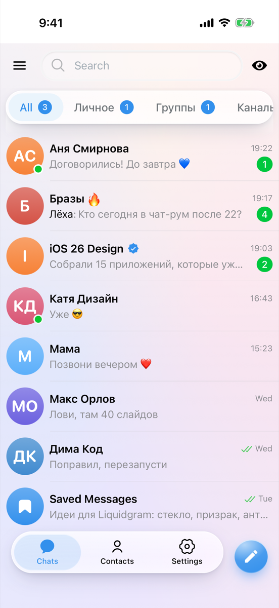

[01-chat-list](screenshots/GestureTests-testChatListRightSwipeKeepsChatList-01-chat-list.png) · [02-chat-list-after-right-swipe](screenshots/GestureTests-testChatListRightSwipeKeepsChatList-02-chat-list-after-right-swipe.png)

### `GestureTests/testLongPressOpensMessageMenu (light)`


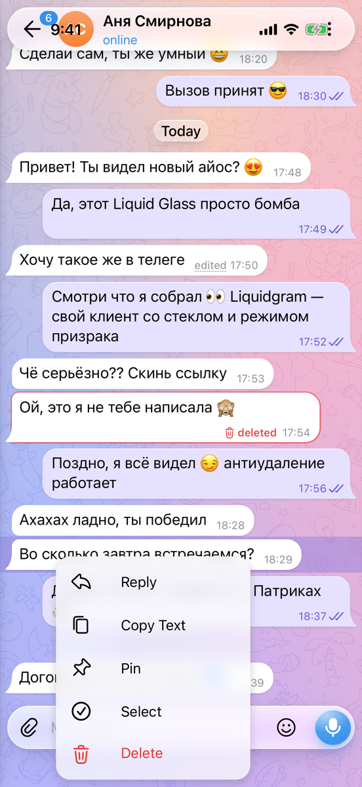
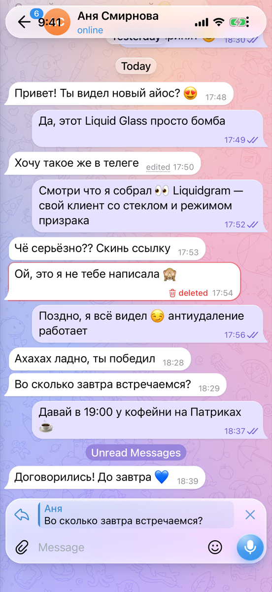

[01-chat](screenshots/GestureTests-testLongPressOpensMessageMenu-01-chat.png) · [02-message-menu](screenshots/GestureTests-testLongPressOpensMessageMenu-02-message-menu.png) · [03-reply-from-menu](screenshots/GestureTests-testLongPressOpensMessageMenu-03-reply-from-menu.png)

### `GestureTests/testSlowShortSwipeSpringsBack (light)`


[01-chat](screenshots/GestureTests-testSlowShortSwipeSpringsBack-01-chat.png) · [02-chat-after-short-swipe](screenshots/GestureTests-testSlowShortSwipeSpringsBack-02-chat-after-short-swipe.png)

### `GestureTests/testSwipeBackClosesProfile (light)`


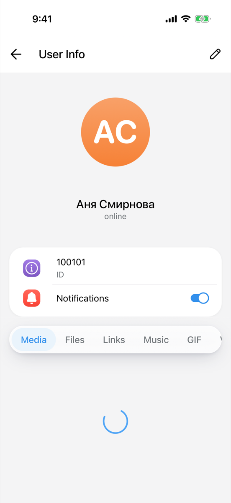


[01-chat](screenshots/GestureTests-testSwipeBackClosesProfile-01-chat.png) · [02-profile](screenshots/GestureTests-testSwipeBackClosesProfile-02-profile.png) · [03-chat-after-profile-swipe](screenshots/GestureTests-testSwipeBackClosesProfile-03-chat-after-profile-swipe.png)

### `GestureTests/testSwipeBackFromEdgeClosesChat (light)`


[01-chat](screenshots/GestureTests-testSwipeBackFromEdgeClosesChat-01-chat.png) · [02-chat-list-after-edge-swipe](screenshots/GestureTests-testSwipeBackFromEdgeClosesChat-02-chat-list-after-edge-swipe.png)

### `GestureTests/testSwipeBackFromMiddleClosesChat (light)`


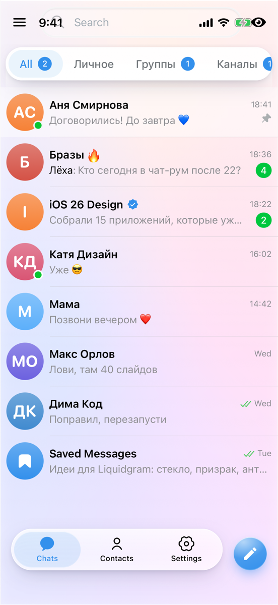

[01-chat](screenshots/GestureTests-testSwipeBackFromMiddleClosesChat-01-chat.png) · [02-chat-list-after-middle-swipe](screenshots/GestureTests-testSwipeBackFromMiddleClosesChat-02-chat-list-after-middle-swipe.png)

### `GestureTests/testSwipeToReply (light)`


[01-chat](screenshots/GestureTests-testSwipeToReply-01-chat.png) · [02-reply-from-swipe](screenshots/GestureTests-testSwipeToReply-02-reply-from-swipe.png)

### `RecordingTests/testHoldRecordsVoiceAndSlidesCancelOrLock (light)`


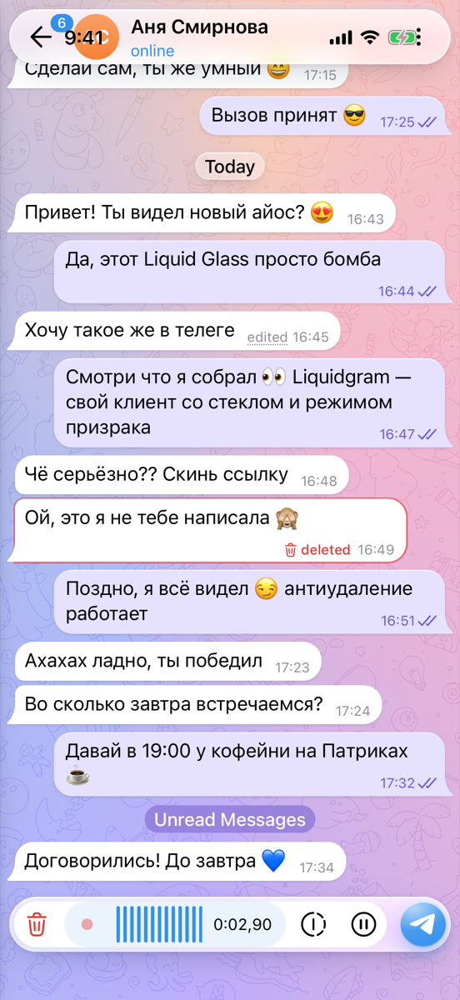


[01-cancelled](screenshots/RecordingTests-testHoldRecordsVoiceAndSlidesCancelOrLock-01-cancelled.png) · [02-locked](screenshots/RecordingTests-testHoldRecordsVoiceAndSlidesCancelOrLock-02-locked.png) · [03-discarded](screenshots/RecordingTests-testHoldRecordsVoiceAndSlidesCancelOrLock-03-discarded.png)

### `RecordingTests/testTapSwitchesBetweenVoiceAndVideo (light)`


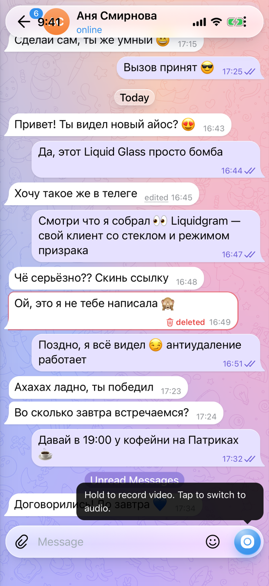
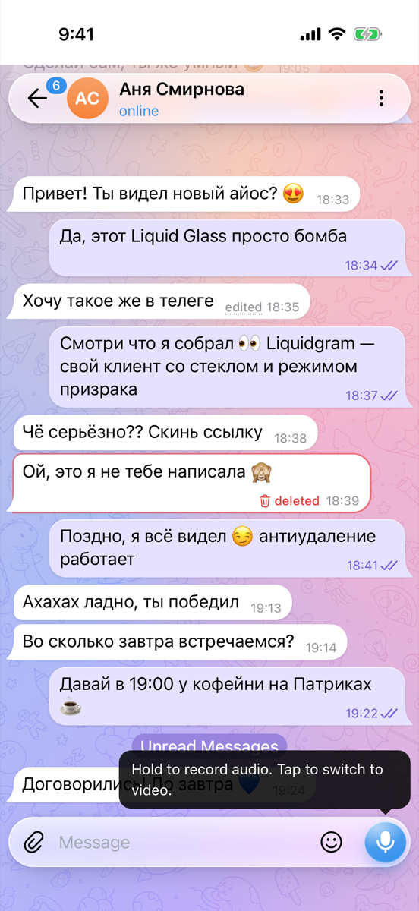

[01-voice-mode](screenshots/RecordingTests-testTapSwitchesBetweenVoiceAndVideo-01-voice-mode.png) · [02-video-mode](screenshots/RecordingTests-testTapSwitchesBetweenVoiceAndVideo-02-video-mode.png) · [03-voice-mode-again](screenshots/RecordingTests-testTapSwitchesBetweenVoiceAndVideo-03-voice-mode-again.png)

### `RoundVideoTests/testCancelDiscardsRecording (light)`

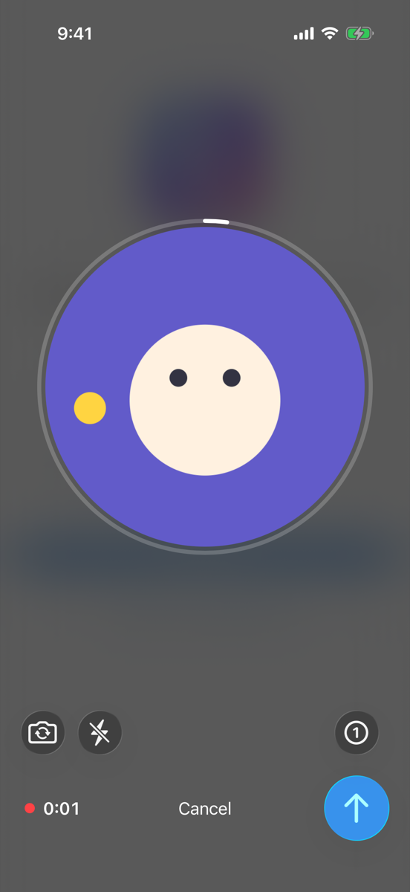


[01-recording](screenshots/RoundVideoTests-testCancelDiscardsRecording-01-recording.png) · [02-after-cancel](screenshots/RoundVideoTests-testCancelDiscardsRecording-02-after-cancel.png)

### `RoundVideoTests/testRecorderExplainsMissingCamera (light)`


[01-no-camera](screenshots/RoundVideoTests-testRecorderExplainsMissingCamera-01-no-camera.png)

### `RoundVideoTests/testRecordsAndSendsRoundVideo (light)`

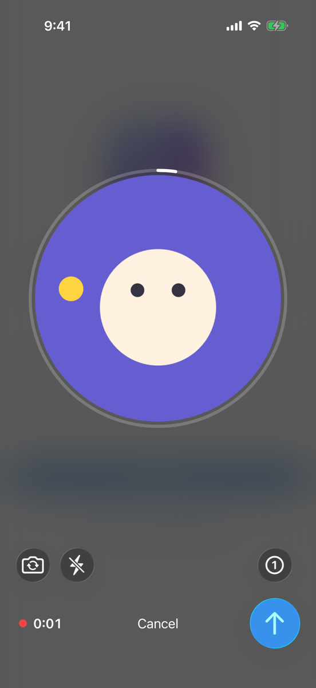
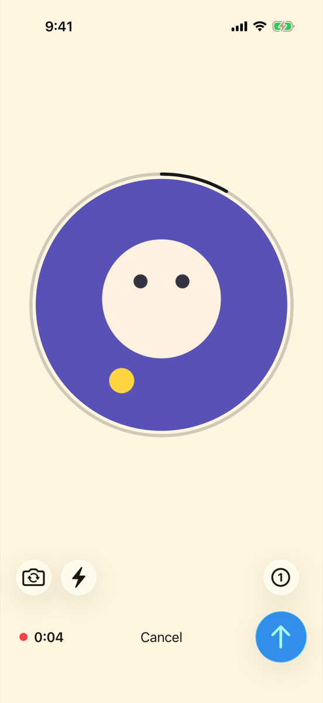
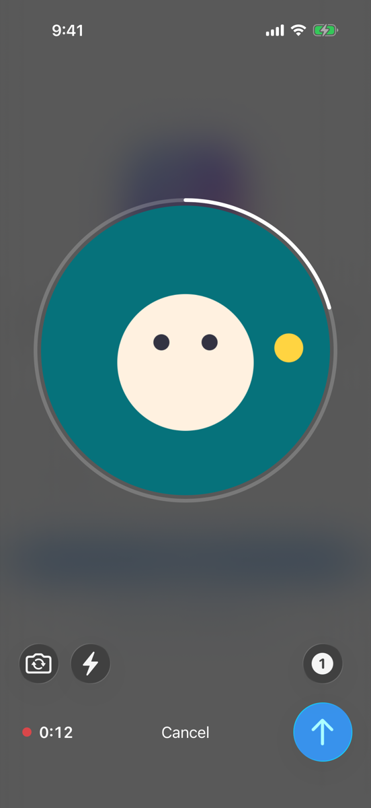


[01-recording](screenshots/RoundVideoTests-testRecordsAndSendsRoundVideo-01-recording.png) · [02-screen-flash](screenshots/RoundVideoTests-testRecordsAndSendsRoundVideo-02-screen-flash.png) · [03-back-camera-view-once](screenshots/RoundVideoTests-testRecordsAndSendsRoundVideo-03-back-camera-view-once.png) · [04-after-send](screenshots/RoundVideoTests-testRecordsAndSendsRoundVideo-04-after-send.png)

### `ShellTests/testIPhoneStaysInPortrait (light)`


[01-turned-sideways](screenshots/ShellTests-testIPhoneStaysInPortrait-01-turned-sideways.png)

### `ShellTests/testKeyboardResizesPageAndRestoresIt (light)`


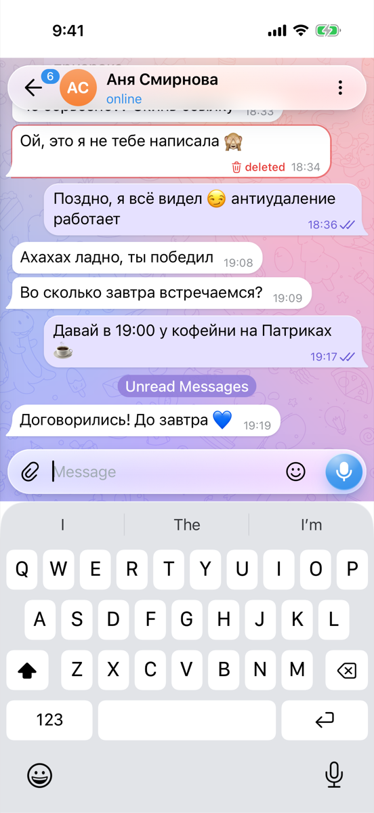


[01-chat-list](screenshots/ShellTests-testKeyboardResizesPageAndRestoresIt-01-chat-list.png) · [02-chat](screenshots/ShellTests-testKeyboardResizesPageAndRestoresIt-02-chat.png) · [03-keyboard-up](screenshots/ShellTests-testKeyboardResizesPageAndRestoresIt-03-keyboard-up.png) · [04-keyboard-hidden](screenshots/ShellTests-testKeyboardResizesPageAndRestoresIt-04-keyboard-hidden.png)

### `TransportTests/testMediaStreamsFromPage (light)`

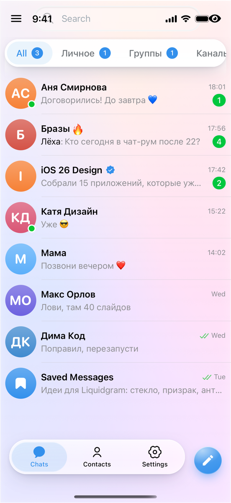

[01-stream-check-finished](screenshots/TransportTests-testMediaStreamsFromPage-01-stream-check-finished.png)

### `UsabilityTests/testAppStaysPortrait (light)`


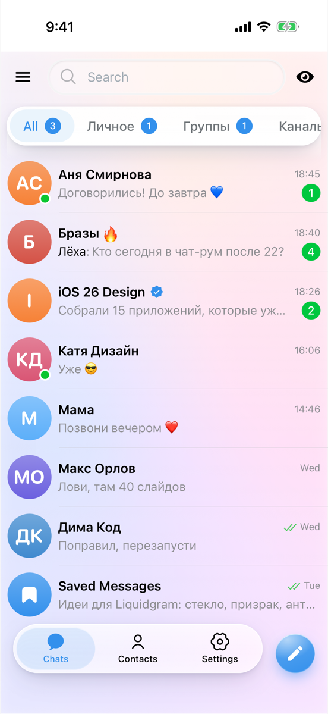

[01-portrait](screenshots/UsabilityTests-testAppStaysPortrait-01-portrait.png) · [02-device-turned](screenshots/UsabilityTests-testAppStaysPortrait-02-device-turned.png)

### `UsabilityTests/testAttachMenuAndEmojiPanelFitOnScreen (light)`

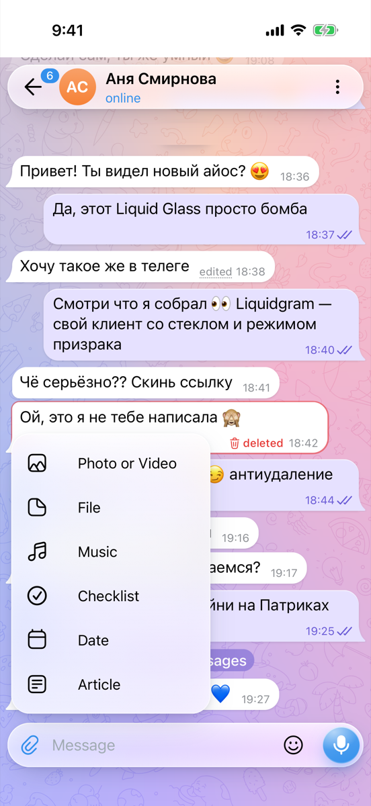


[01-attach-menu](screenshots/UsabilityTests-testAttachMenuAndEmojiPanelFitOnScreen-01-attach-menu.png) · [02-emoji-panel](screenshots/UsabilityTests-testAttachMenuAndEmojiPanelFitOnScreen-02-emoji-panel.png)

### `UsabilityTests/testChatListTopRowWorks (light)`


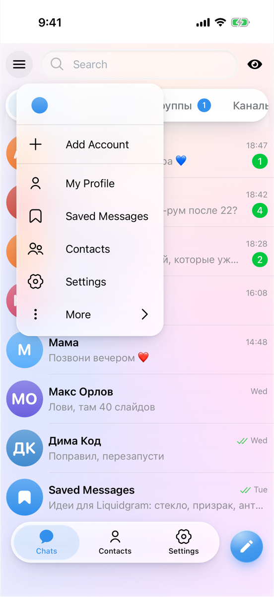
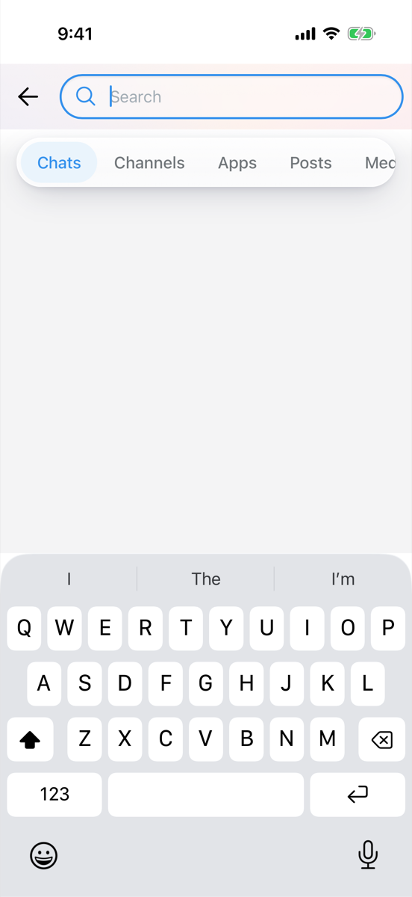
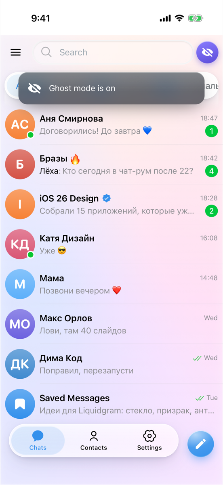

[01-chat-list](screenshots/UsabilityTests-testChatListTopRowWorks-01-chat-list.png) · [02-main-menu](screenshots/UsabilityTests-testChatListTopRowWorks-02-main-menu.png) · [03-search](screenshots/UsabilityTests-testChatListTopRowWorks-03-search.png) · [04-ghost-mode](screenshots/UsabilityTests-testChatListTopRowWorks-04-ghost-mode.png)

### `UsabilityTests/testChatTopRowWorks (light)`

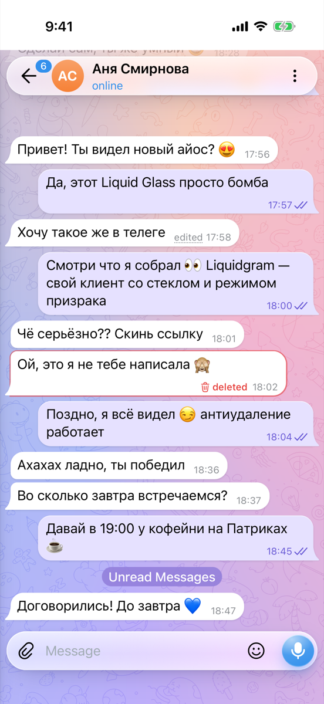
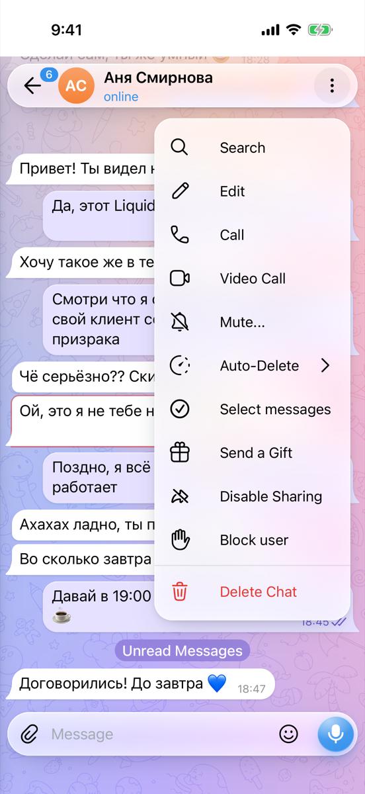

[01-chat](screenshots/UsabilityTests-testChatTopRowWorks-01-chat.png) · [02-chat-menu](screenshots/UsabilityTests-testChatTopRowWorks-02-chat-menu.png)

### `UsabilityTests/testDelayedWindowOpenShowsInAppBrowser (light)`

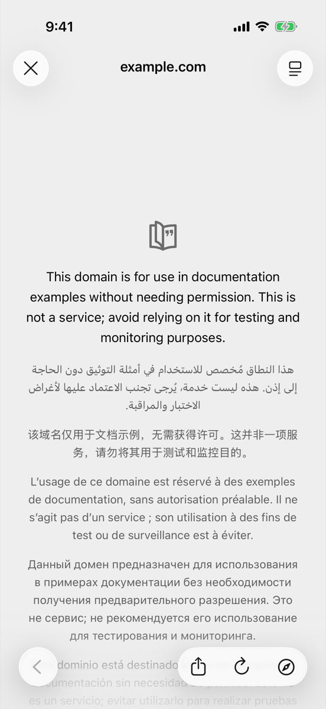

[01-in-app-browser](screenshots/UsabilityTests-testDelayedWindowOpenShowsInAppBrowser-01-in-app-browser.png)

### `UsabilityTests/testDraggingMessagesHidesKeyboard (light)`


[01-keyboard-up](screenshots/UsabilityTests-testDraggingMessagesHidesKeyboard-01-keyboard-up.png) · [02-after-drag](screenshots/UsabilityTests-testDraggingMessagesHidesKeyboard-02-after-drag.png)

### `UsabilityTests/testKeyboardKeepsChatLayout (light)`


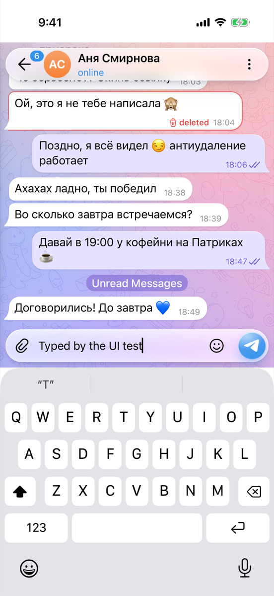

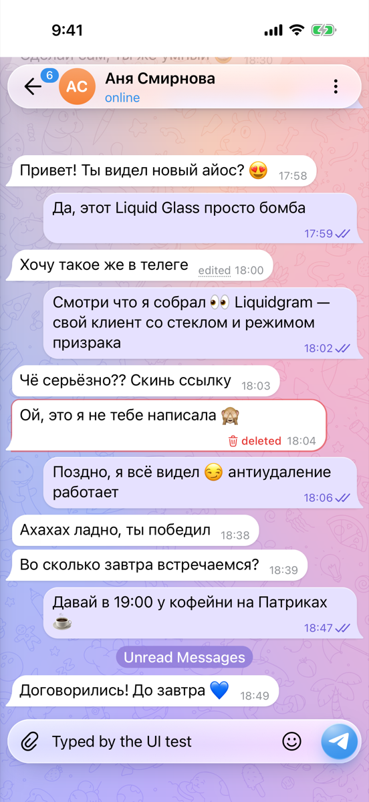


[01-chat](screenshots/UsabilityTests-testKeyboardKeepsChatLayout-01-chat.png) · [02-keyboard](screenshots/UsabilityTests-testKeyboardKeepsChatLayout-02-keyboard.png) · [03-keyboard-hidden](screenshots/UsabilityTests-testKeyboardKeepsChatLayout-03-keyboard-hidden.png) · [04-after-keyboard-cycles](screenshots/UsabilityTests-testKeyboardKeepsChatLayout-04-after-keyboard-cycles.png) · [failure-the-chat-with-the-keyboard-the-page-scrolled](screenshots/UsabilityTests-testKeyboardKeepsChatLayout-failure-the-chat-with-the-keyboard-the-page-scrolled.png)

### `UsabilityTests/testLongPressOnMessageOpensMenu (light)`

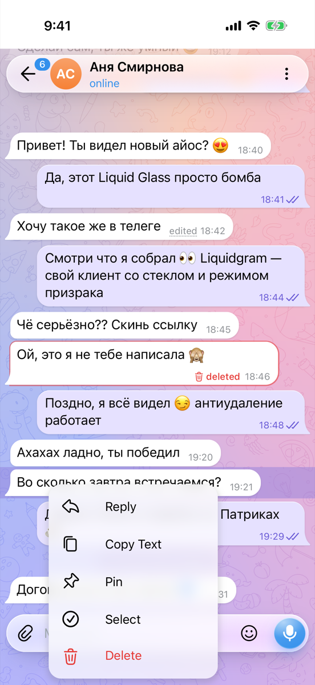
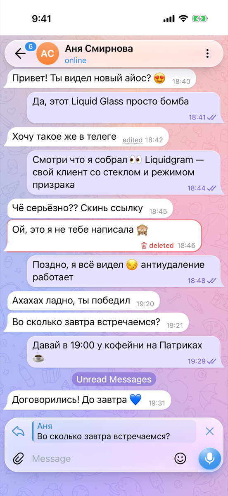

[01-message-menu](screenshots/UsabilityTests-testLongPressOnMessageOpensMenu-01-message-menu.png) · [02-reply](screenshots/UsabilityTests-testLongPressOnMessageOpensMenu-02-reply.png)

### `UsabilityTests/testMediaViewerOpensAndCloses (light)`

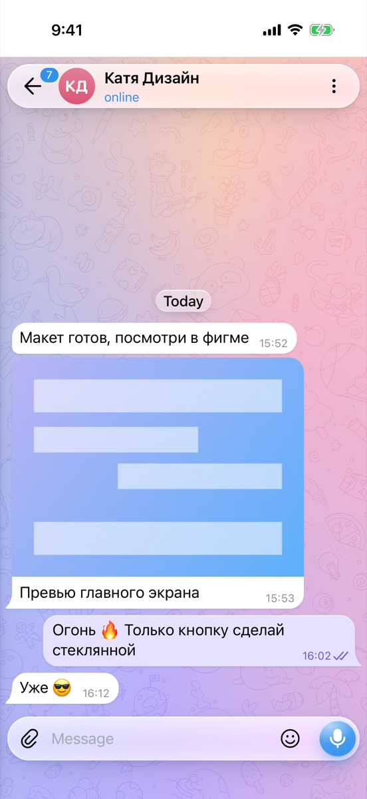
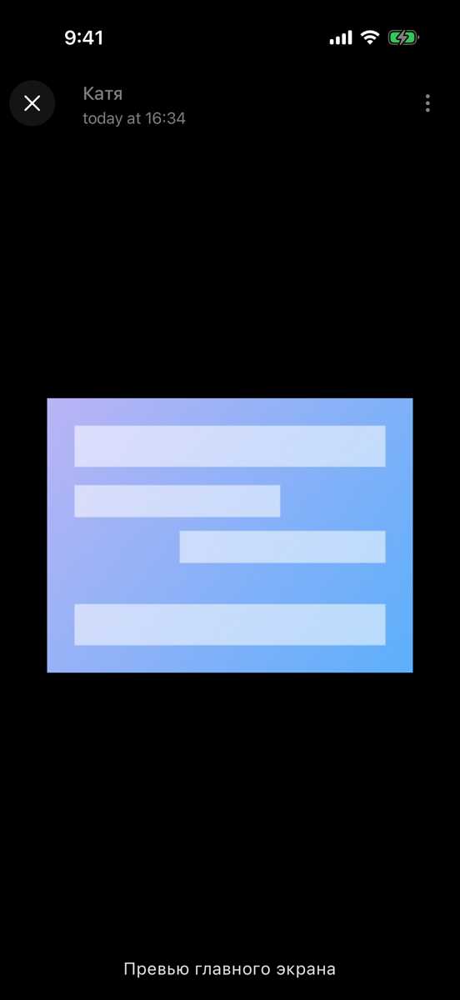


[01-chat-with-photo](screenshots/UsabilityTests-testMediaViewerOpensAndCloses-01-chat-with-photo.png) · [02-media-viewer](screenshots/UsabilityTests-testMediaViewerOpensAndCloses-02-media-viewer.png) · [03-media-viewer-closed](screenshots/UsabilityTests-testMediaViewerOpensAndCloses-03-media-viewer-closed.png)

### `UsabilityTests/testPageIsActiveBeforeFirstTap (light)`


[01-chat-list-untouched](screenshots/UsabilityTests-testPageIsActiveBeforeFirstTap-01-chat-list-untouched.png)

### `UsabilityTests/testProfileTopRowWorks (light)`


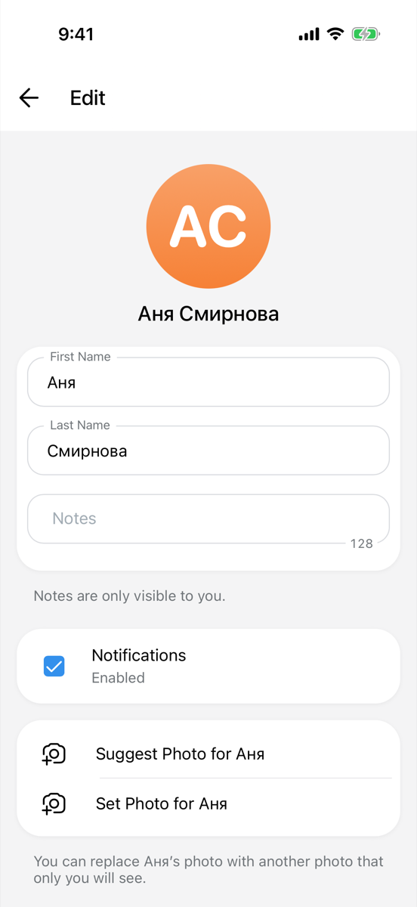


[01-profile](screenshots/UsabilityTests-testProfileTopRowWorks-01-profile.png) · [02-edit-contact](screenshots/UsabilityTests-testProfileTopRowWorks-02-edit-contact.png) · [03-chat-after-back](screenshots/UsabilityTests-testProfileTopRowWorks-03-chat-after-back.png)

### `UsabilityTests/testSettingsTopRowWorks (light)`

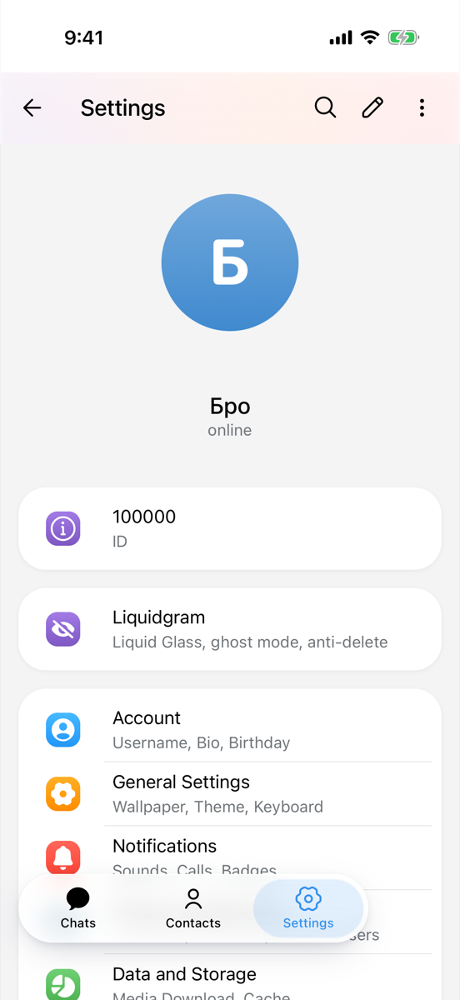
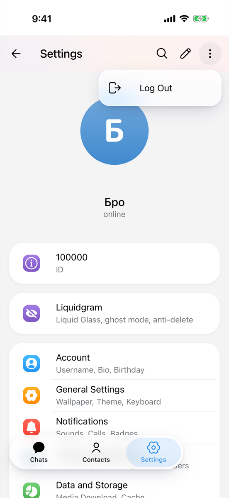
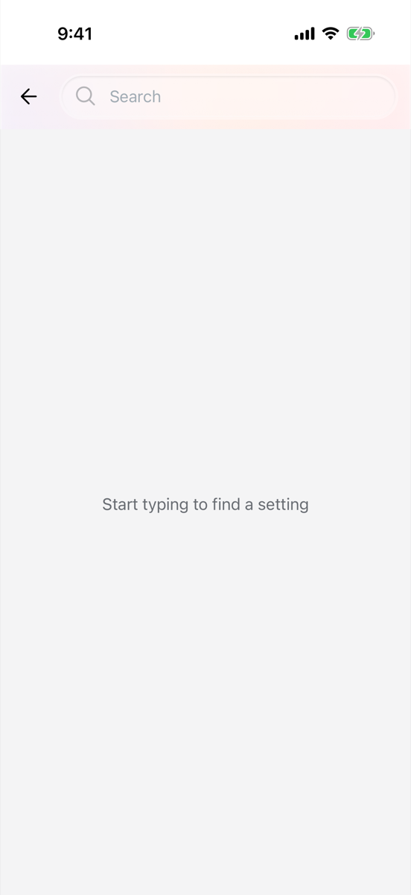
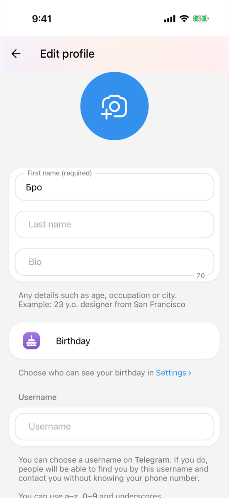
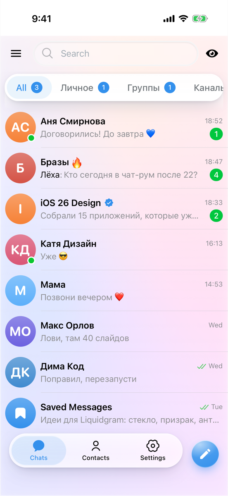

[01-settings](screenshots/UsabilityTests-testSettingsTopRowWorks-01-settings.png) · [02-settings-menu](screenshots/UsabilityTests-testSettingsTopRowWorks-02-settings-menu.png) · [03-settings-search](screenshots/UsabilityTests-testSettingsTopRowWorks-03-settings-search.png) · [04-edit-profile](screenshots/UsabilityTests-testSettingsTopRowWorks-04-edit-profile.png) · [05-chat-list](screenshots/UsabilityTests-testSettingsTopRowWorks-05-chat-list.png)

### `UsabilityTests/testStatusBarStripMatchesTheme (light)`


[01-status-bar-strip](screenshots/UsabilityTests-testStatusBarStripMatchesTheme-01-status-bar-strip.png)

### `CoreTests/testDemoAccount (dark)`

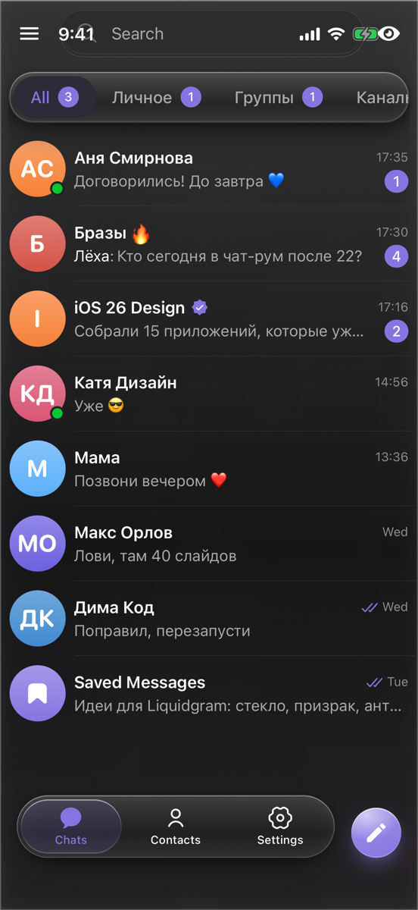
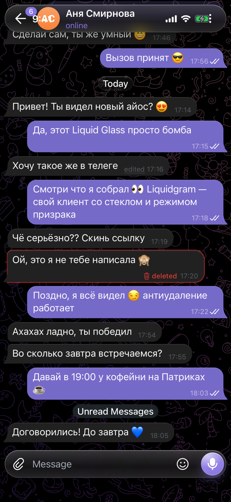


[01-chat-list-dark](screenshots/CoreTests-testDemoAccount-01-chat-list-dark.png) · [02-chat-dark](screenshots/CoreTests-testDemoAccount-02-chat-dark.png) · [03-composer-with-keyboard-dark](screenshots/CoreTests-testDemoAccount-03-composer-with-keyboard-dark.png)

### `UsabilityTests/testStatusBarStripMatchesTheme (dark)`


[01-status-bar-strip-dark](screenshots/UsabilityTests-testStatusBarStripMatchesTheme-01-status-bar-strip-dark.png)

