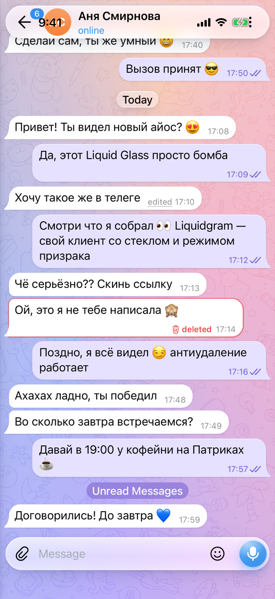
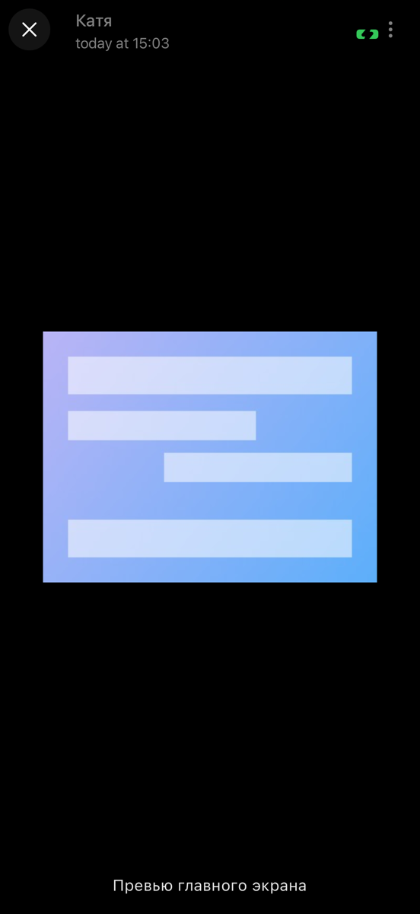
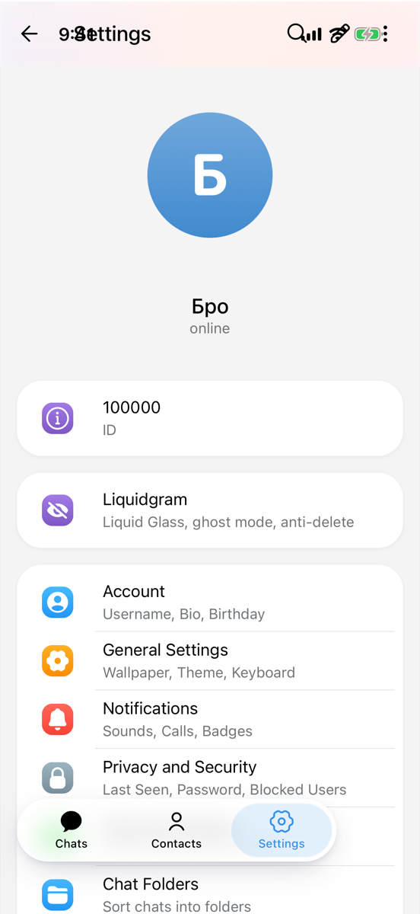

# Liquidgram UI tests

**Failed**: 16 passed, 14 failed, 0 skipped.

- Device: iPhone 17 Pro, iOS 26.2
- Branch: `ios-v2/fix-tests-ux` at `05edd1d`
- Run: https://github.com/levaasd142-cmd/liquidgram/actions/runs/40925386142
- Generated: 2026-10-29T18:05:17.144Z

## Tests

| Test | Pass | Status | Duration | Failure |
| --- | --- | --- | --- | --- |
| `CoreTests/testColdStartShowsApiKeysScreen` | light | Passed | 12.5 s |  |
| `CoreTests/testDemoAccount` | light | Passed | 18.8 s |  |
| `CoreTests/testDemoAccountSurvivesRestart` | light | Passed | 18.5 s |  |
| `CoreTests/testKeyboardKeepsFocusedFieldVisible` | light | Passed | 6.3 s |  |
| `CoreTests/testWebAppSelfTest` | light | Passed | 8.7 s |  |
| `FeatureTests/testAppLockOpensAndLocksAgainAfterBackground` | light | Passed | 19.5 s |  |
| `FeatureTests/testAppLockStaysLockedWhenAuthenticationFails` | light | Passed | 12.9 s |  |
| `FeatureTests/testDeepLinkOpensSettings` | light | Passed | 11.0 s |  |
| `FeatureTests/testKeyboardHasNoFormToolbar` | light | Passed | 7.4 s |  |
| `FeatureTests/testLiquidgramSettingsShowIPhoneSection` | light | Passed | 11.6 s |  |
| `FeatureTests/testPrivacyShieldCoversAppWhileInactive` | light | Passed | 14.1 s |  |
| `FeatureTests/testQuickActionFocusesSearch` | light | Failed | 44.8 s | FeatureTests.swift:163: failed - Not found within 40 s: the keyboard of the focused search |
| `FeatureTests/testQuickActionOpensNewMessage` | light | Passed | 7.4 s |  |
| `FeatureTests/testQuickActionOpensSavedMessages` | light | Passed | 6.7 s |  |
| `FeatureTests/testQuickActionTogglesGhostMode` | light | Passed | 6.1 s |  |
| `UsabilityTests/testAppStaysPortrait` | light | Failed | 7.3 s | UsabilityTests.swift:499: failed - The app turned to landscape with the device: its window is (0, 0, 874×402) instead of (0, 0, 402×874) and the page is 874×402 |
| `UsabilityTests/testAttachMenuAndEmojiPanelFitOnScreen` | light | Failed | 32.4 s | UsabilityTests.swift:625: failed - The panels of the composer: The Emoji tab of the emoji panel at (126, 833, 34×34) is not entirely between the status bar and y 840; The Stickers tab of the emoji panel at (184, 833, 34×34) is not entirely between the status bar and y 840; The GIFs tab of the emoji panel at (242, 833, 34×34) is not entirely between the status bar and y 840 |
| `UsabilityTests/testChatListTopRowWorks` | light | Failed | 25.2 s | UsabilityTests.swift:176: failed - The top row of the chat list: Open menu at (8, 12, 40×40) is under the status bar, which ends at y 54; The search field at (96, 12, 201×40) is under the status bar, which ends at y 54; Ghost mode at (354, 12, 40×40) is under the status bar, which ends at y 54; A tap on Open menu at (8, 12, 40×40) did not open the main menu; A tap on the search field at (96, 12, 201×40) brought up no keyboard; A tap on Ghost mode at (354, 12, 40×40) showed no toast |
| `UsabilityTests/testChatTopRowWorks` | light | Failed | 29.8 s | UsabilityTests.swift:233: failed - The top row of a chat: Back at (16, 12, 40×40) is under the status bar, which ends at y 54; The chat title at (114, 11, 121×24) is under the status bar, which ends at y 54; More options at (346, 12, 40×40) is under the status bar, which ends at y 54; A tap on More options at (346, 12, 40×40) did not open the menu of the chat; A tap on the chat title at (114, 11, 121×24) did not open the profile; A tap on Back at (16, 12, 40×40) did not return to the chat list |
| `UsabilityTests/testDelayedWindowOpenShowsInAppBrowser` | light | Failed | 25.2 s | UsabilityTests.swift:712: failed - No in-app browser within 12 s after the page called window.open 1.5 s after a tap |
| `UsabilityTests/testDraggingMessagesHidesKeyboard` | light | Failed | 20.2 s | UsabilityTests.swift:468: failed - The keyboard stayed up after a drag down on the messages from y 183 to y 383 |
| `UsabilityTests/testKeyboardKeepsChatLayout` | light | Failed | 25.7 s | UsabilityTests.swift:443: failed - The chat with the keyboard: The page goes on under the keyboard: it ends at y 874, the keyboard starts at y 539; The header moved with the keyboard: Back is at (16, -323, 40×40) instead of (16, 12, 40×40); The newest message at (21, 474, 208×22) is not between the header and the composer at (56, 487, 234×40); The page scrolled with the keyboard: pageTop 335.0, offsetTop 335.0, scrollTop 335.0, scrollY 335.0; The page scrolled during the keyboard cycles: highest pageTop 335.0, offsetTop 335.0, scrollTop 335.0, scrollY 335.0 |
| `UsabilityTests/testLongPressOnMessageOpensMenu` | light | Passed | 15.4 s |  |
| `UsabilityTests/testMediaViewerOpensAndCloses` | light | Failed | 16.0 s | UsabilityTests.swift:661: failed - The media viewer: The Close button of the media viewer at (8, 8, 40×40) is under the status bar, which ends at y 54; A tap on Close at (8, 8, 40×40) did not close the media viewer |
| `UsabilityTests/testPageIsActiveBeforeFirstTap` | light | Failed | 6.3 s | UsabilityTests.swift:565: failed - The page treats itself as being in the background until the first tap (body.in-background; document.hasFocus() is false), so its animations stand still |
| `UsabilityTests/testProfileTopRowWorks` | light | Failed | 14.0 s | UsabilityTests.swift:249: failed - The top row of a profile: The chat title at (114, 11, 121×24) is under the status bar, which ends at y 54; A tap on the chat title at (114, 11, 121×24) did not open the profile |
| `UsabilityTests/testSettingsTopRowWorks` | light | Failed | 32.2 s | UsabilityTests.swift:349: failed - The top row of the settings: Go back at (8, 12, 40×40) is under the status bar, which ends at y 54; Search at (265, 12, 40×40) is under the status bar, which ends at y 54; Edit profile at (305, 12, 40×40) is under the status bar, which ends at y 54; More options at (349, 12, 40×40) is under the status bar, which ends at y 54; A tap on More options at (349, 12, 40×40) did not open the settings menu; A tap on Search at (265, 12, 40×40) did not open the settings search; A tap on Edit profile at (305, 12, 40×40) did not open the profile editor; A tap on Go back at (8, 12, 40×40) did not return to the chat list |
| `UsabilityTests/testStatusBarStripMatchesTheme` | light | Failed | 6.9 s | UsabilityTests.swift:550: failed - The status bar strip in the light theme: The page starts at y 0, under the status bar, which ends at y 54, so the status bar shows the page instead of a strip in the theme color; The strip at y 2 shows #f7f2f6, #faf3f7, #f9f3f5, #fbf3f5, #fdf4f4, #fef4f3, #fff4f2, #fef3f0, #fef4ef, #fff4ef, #fff3ef, #fff2ef, #fff3f1, #fef1f0 instead of the theme color #fff; The strip at y 51 shows #f6eef6, #f8f0f6, #f9f6f9, #fbf8f9, #fcf8f8, #fdf8f8, #fdf8f7, #fcf6f5, #fdf7f4, #fef8f6, #fcf6f4, #fef8f5, #fef7f6, #fdf7f5, #fcf5f5, #ffefee, #feedee instead of the theme color #fff |
| `CoreTests/testDemoAccount` | dark | Passed | 17.9 s |  |
| `UsabilityTests/testStatusBarStripMatchesTheme` | dark | Failed | 8.0 s | UsabilityTests.swift:550: failed - The status bar strip in the dark theme: The page starts at y 0, under the status bar, which ends at y 54, so the status bar shows the page instead of a strip in the theme color; The strip at y 2 shows #383738, #393738, #373837, #383737, #393838, #383839, #383838, #393737, #383837 instead of the theme color #212121; The strip at y 51 shows #313031, #3d3d3d, #3e3d3d, #313030, #312f30 instead of the theme color #212121 |

## Self-test (light)

| Check | Result | Detail |
| --- | --- | --- |
| `bridge` | ok | version 1.0.0, notification permission default |
| `notificationBridge` | ok | permission default |
| `noServiceWorker` | ok | service workers are unavailable |
| `secureContext` | ok | http://127.0.0.1:47821 |
| `webCrypto` | ok | SHA-256 digest matches |
| `localStorage` | ok | write, read and remove work |
| `indexedDb` | ok | open, put and get work |
| `webAssembly` | ok | a module compiles and runs |
| `worker` | ok | a module worker from the app's origin answered (secure context true) |
| `fetchIndex` | ok | status 200, text/html; charset=utf-8 |
| `rangeRequest` | ok | /assets/index-v9lLG9Y1.js: 206 with bytes 100-1123/159267 |
| `userAgentMobile` | ok | Mozilla/5.0 (iPhone; CPU iPhone OS 18_7 like Mac OS X) AppleWebKit/605.1.15 (KHTML, like Gecko) Mobile/15E148 Liquidgram |
| `userAgentLiquidgram` | ok | Mozilla/5.0 (iPhone; CPU iPhone OS 18_7 like Mac OS X) AppleWebKit/605.1.15 (KHTML, like Gecko) Mobile/15E148 Liquidgram |
| `appRendered` | ok | Transition full-height is-auth |
| `compatTest` | ok | passed |
| `noPageErrors` | ok | none since the page started |

<details><summary>Page details</summary>

```json
{
  "url": "http://127.0.0.1:47821/",
  "userAgent": "Mozilla/5.0 (iPhone; CPU iPhone OS 18_7 like Mac OS X) AppleWebKit/605.1.15 (KHTML, like Gecko) Mobile/15E148 Liquidgram",
  "language": "en-US",
  "viewport": "402x874 at 3x",
  "colorScheme": "light",
  "backdropFilter": true,
  "blobWorker": "blocked: Error: worker error: the script did not load",
  "authScreen": true
}
```

</details>

Folders: [`screenshots/`](screenshots), [`ax/`](ax) (accessibility trees of failed tests), [`logs/`](logs) (app log, xcodebuild output, self-test reports).

## Screenshots

All screenshots at a glance, with a band for the test's result: green passed, red failed, orange the moment of the failure.


### `CoreTests/testColdStartShowsApiKeysScreen (light)`


[01-api-keys-screen](screenshots/CoreTests-testColdStartShowsApiKeysScreen-01-api-keys-screen.png)

### `CoreTests/testDemoAccount (light)`


[01-chat-list](screenshots/CoreTests-testDemoAccount-01-chat-list.png) · [02-chat](screenshots/CoreTests-testDemoAccount-02-chat.png) · [03-composer-with-keyboard](screenshots/CoreTests-testDemoAccount-03-composer-with-keyboard.png)

### `CoreTests/testDemoAccountSurvivesRestart (light)`


[01-chat-list-before-restart](screenshots/CoreTests-testDemoAccountSurvivesRestart-01-chat-list-before-restart.png) · [02-chat-list-after-restart](screenshots/CoreTests-testDemoAccountSurvivesRestart-02-chat-list-after-restart.png)

### `CoreTests/testKeyboardKeepsFocusedFieldVisible (light)`


[01-keyboard-up](screenshots/CoreTests-testKeyboardKeepsFocusedFieldVisible-01-keyboard-up.png)

### `CoreTests/testWebAppSelfTest (light)`


[01-self-test-finished](screenshots/CoreTests-testWebAppSelfTest-01-self-test-finished.png)

### `FeatureTests/testAppLockOpensAndLocksAgainAfterBackground (light)`


[01-locked-at-launch](screenshots/FeatureTests-testAppLockOpensAndLocksAgainAfterBackground-01-locked-at-launch.png) · [02-unlocked](screenshots/FeatureTests-testAppLockOpensAndLocksAgainAfterBackground-02-unlocked.png) · [03-locked-after-background](screenshots/FeatureTests-testAppLockOpensAndLocksAgainAfterBackground-03-locked-after-background.png) · [04-unlocked-again](screenshots/FeatureTests-testAppLockOpensAndLocksAgainAfterBackground-04-unlocked-again.png)

### `FeatureTests/testAppLockStaysLockedWhenAuthenticationFails (light)`


[01-failed-authentication](screenshots/FeatureTests-testAppLockStaysLockedWhenAuthenticationFails-01-failed-authentication.png) · [02-failed-again](screenshots/FeatureTests-testAppLockStaysLockedWhenAuthenticationFails-02-failed-again.png)

### `FeatureTests/testDeepLinkOpensSettings (light)`


[01-settings-from-deep-link](screenshots/FeatureTests-testDeepLinkOpensSettings-01-settings-from-deep-link.png)

### `FeatureTests/testKeyboardHasNoFormToolbar (light)`


[01-keyboard](screenshots/FeatureTests-testKeyboardHasNoFormToolbar-01-keyboard.png)

### `FeatureTests/testLiquidgramSettingsShowIPhoneSection (light)`


[01-liquidgram-settings](screenshots/FeatureTests-testLiquidgramSettingsShowIPhoneSection-01-liquidgram-settings.png) · [02-iphone-section](screenshots/FeatureTests-testLiquidgramSettingsShowIPhoneSection-02-iphone-section.png)

### `FeatureTests/testPrivacyShieldCoversAppWhileInactive (light)`


[01-shield-under-notification-center](screenshots/FeatureTests-testPrivacyShieldCoversAppWhileInactive-01-shield-under-notification-center.png) · [02-shield-removed](screenshots/FeatureTests-testPrivacyShieldCoversAppWhileInactive-02-shield-removed.png) · [03-app-switcher](screenshots/FeatureTests-testPrivacyShieldCoversAppWhileInactive-03-app-switcher.png)

### `FeatureTests/testQuickActionFocusesSearch (light)`


[failure-the-keyboard-of-the-focused-search](screenshots/FeatureTests-testQuickActionFocusesSearch-failure-the-keyboard-of-the-focused-search.png)

### `FeatureTests/testQuickActionOpensNewMessage (light)`


[01-new-message](screenshots/FeatureTests-testQuickActionOpensNewMessage-01-new-message.png)

### `FeatureTests/testQuickActionOpensSavedMessages (light)`


[01-saved-messages](screenshots/FeatureTests-testQuickActionOpensSavedMessages-01-saved-messages.png)

### `FeatureTests/testQuickActionTogglesGhostMode (light)`


[01-ghost-mode-toast](screenshots/FeatureTests-testQuickActionTogglesGhostMode-01-ghost-mode-toast.png)

### `UsabilityTests/testAppStaysPortrait (light)`


[01-portrait](screenshots/UsabilityTests-testAppStaysPortrait-01-portrait.png) · [02-device-turned](screenshots/UsabilityTests-testAppStaysPortrait-02-device-turned.png) · [failure-the-app-turned-to-landscape-with-the-device-its](screenshots/UsabilityTests-testAppStaysPortrait-failure-the-app-turned-to-landscape-with-the-device-its.png)

### `UsabilityTests/testAttachMenuAndEmojiPanelFitOnScreen (light)`


[01-attach-menu](screenshots/UsabilityTests-testAttachMenuAndEmojiPanelFitOnScreen-01-attach-menu.png) · [02-emoji-panel](screenshots/UsabilityTests-testAttachMenuAndEmojiPanelFitOnScreen-02-emoji-panel.png) · [failure-the-panels-of-the-composer-the-emoji-tab-of-the](screenshots/UsabilityTests-testAttachMenuAndEmojiPanelFitOnScreen-failure-the-panels-of-the-composer-the-emoji-tab-of-the.png)

### `UsabilityTests/testChatListTopRowWorks (light)`


[01-chat-list](screenshots/UsabilityTests-testChatListTopRowWorks-01-chat-list.png) · [04-ghost-mode](screenshots/UsabilityTests-testChatListTopRowWorks-04-ghost-mode.png) · [failure-the-top-row-of-the-chat-list-open-menu-at-8-12](screenshots/UsabilityTests-testChatListTopRowWorks-failure-the-top-row-of-the-chat-list-open-menu-at-8-12.png)

### `UsabilityTests/testChatTopRowWorks (light)`




[01-chat](screenshots/UsabilityTests-testChatTopRowWorks-01-chat.png) · [04-chat-list-after-back](screenshots/UsabilityTests-testChatTopRowWorks-04-chat-list-after-back.png) · [failure-the-top-row-of-a-chat-back-at-16-12-40-40-is](screenshots/UsabilityTests-testChatTopRowWorks-failure-the-top-row-of-a-chat-back-at-16-12-40-40-is.png)

### `UsabilityTests/testDelayedWindowOpenShowsInAppBrowser (light)`


[01-in-app-browser](screenshots/UsabilityTests-testDelayedWindowOpenShowsInAppBrowser-01-in-app-browser.png) · [failure-no-in-app-browser-within-12-s-after-the-page](screenshots/UsabilityTests-testDelayedWindowOpenShowsInAppBrowser-failure-no-in-app-browser-within-12-s-after-the-page.png)

### `UsabilityTests/testDraggingMessagesHidesKeyboard (light)`


[01-keyboard-up](screenshots/UsabilityTests-testDraggingMessagesHidesKeyboard-01-keyboard-up.png) · [02-after-drag](screenshots/UsabilityTests-testDraggingMessagesHidesKeyboard-02-after-drag.png) · [failure-the-keyboard-stayed-up-after-a-drag-down-on-the](screenshots/UsabilityTests-testDraggingMessagesHidesKeyboard-failure-the-keyboard-stayed-up-after-a-drag-down-on-the.png)

### `UsabilityTests/testKeyboardKeepsChatLayout (light)`


[01-chat](screenshots/UsabilityTests-testKeyboardKeepsChatLayout-01-chat.png) · [02-keyboard](screenshots/UsabilityTests-testKeyboardKeepsChatLayout-02-keyboard.png) · [03-keyboard-hidden](screenshots/UsabilityTests-testKeyboardKeepsChatLayout-03-keyboard-hidden.png) · [04-after-keyboard-cycles](screenshots/UsabilityTests-testKeyboardKeepsChatLayout-04-after-keyboard-cycles.png) · [failure-the-chat-with-the-keyboard-the-page-goes-on](screenshots/UsabilityTests-testKeyboardKeepsChatLayout-failure-the-chat-with-the-keyboard-the-page-goes-on.png)

### `UsabilityTests/testLongPressOnMessageOpensMenu (light)`


[01-message-menu](screenshots/UsabilityTests-testLongPressOnMessageOpensMenu-01-message-menu.png) · [02-reply](screenshots/UsabilityTests-testLongPressOnMessageOpensMenu-02-reply.png)

### `UsabilityTests/testMediaViewerOpensAndCloses (light)`




[01-chat-with-photo](screenshots/UsabilityTests-testMediaViewerOpensAndCloses-01-chat-with-photo.png) · [02-media-viewer](screenshots/UsabilityTests-testMediaViewerOpensAndCloses-02-media-viewer.png) · [03-media-viewer-closed](screenshots/UsabilityTests-testMediaViewerOpensAndCloses-03-media-viewer-closed.png) · [failure-the-media-viewer-the-close-button-of-the-media](screenshots/UsabilityTests-testMediaViewerOpensAndCloses-failure-the-media-viewer-the-close-button-of-the-media.png)

### `UsabilityTests/testPageIsActiveBeforeFirstTap (light)`


[01-chat-list-untouched](screenshots/UsabilityTests-testPageIsActiveBeforeFirstTap-01-chat-list-untouched.png) · [failure-the-page-treats-itself-as-being-in-the](screenshots/UsabilityTests-testPageIsActiveBeforeFirstTap-failure-the-page-treats-itself-as-being-in-the.png)

### `UsabilityTests/testProfileTopRowWorks (light)`


[failure-the-top-row-of-a-profile-the-chat-title-at-114](screenshots/UsabilityTests-testProfileTopRowWorks-failure-the-top-row-of-a-profile-the-chat-title-at-114.png)

### `UsabilityTests/testSettingsTopRowWorks (light)`




[01-settings](screenshots/UsabilityTests-testSettingsTopRowWorks-01-settings.png) · [05-chat-list](screenshots/UsabilityTests-testSettingsTopRowWorks-05-chat-list.png) · [failure-the-top-row-of-the-settings-go-back-at-8-12-40](screenshots/UsabilityTests-testSettingsTopRowWorks-failure-the-top-row-of-the-settings-go-back-at-8-12-40.png)

### `UsabilityTests/testStatusBarStripMatchesTheme (light)`


[01-status-bar-strip](screenshots/UsabilityTests-testStatusBarStripMatchesTheme-01-status-bar-strip.png) · [failure-the-status-bar-strip-in-the-light-theme-the-page](screenshots/UsabilityTests-testStatusBarStripMatchesTheme-failure-the-status-bar-strip-in-the-light-theme-the-page.png)

### `CoreTests/testDemoAccount (dark)`


[01-chat-list-dark](screenshots/CoreTests-testDemoAccount-01-chat-list-dark.png) · [02-chat-dark](screenshots/CoreTests-testDemoAccount-02-chat-dark.png) · [03-composer-with-keyboard-dark](screenshots/CoreTests-testDemoAccount-03-composer-with-keyboard-dark.png)

### `UsabilityTests/testStatusBarStripMatchesTheme (dark)`


[01-status-bar-strip-dark](screenshots/UsabilityTests-testStatusBarStripMatchesTheme-01-status-bar-strip-dark.png) · [failure-the-status-bar-strip-in-the-dark-theme-the-page-dark](screenshots/UsabilityTests-testStatusBarStripMatchesTheme-failure-the-status-bar-strip-in-the-dark-theme-the-page-dark.png)

