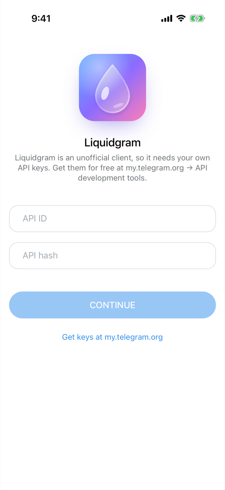
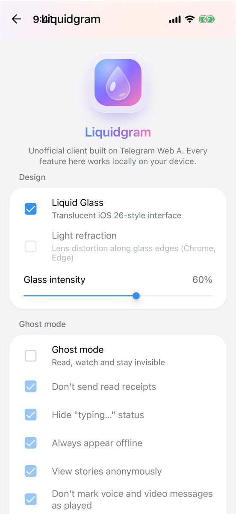
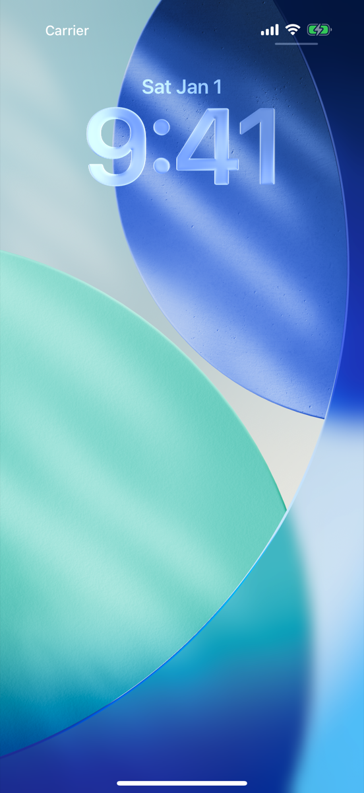
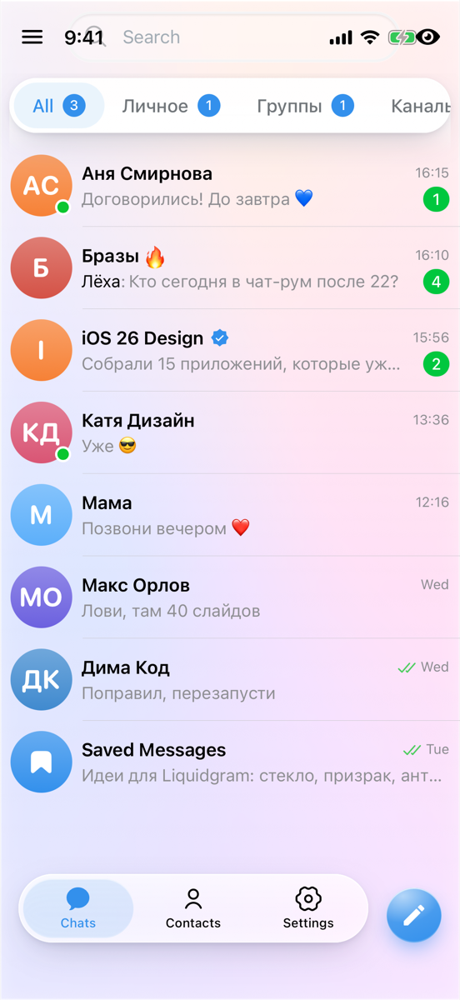

# Liquidgram UI tests

**Failed**: 5 passed, 13 failed (1 known), 0 skipped.

- Device: iPhone 17 Pro, iOS 26.2
- Branch: `ios-v2/tests` at `dba12f1`
- Run: https://github.com/levaasd142-cmd/liquidgram/actions/runs/40908415194
- Generated: 2026-10-29T16:19:00.097Z

## Tests

| Test | Pass | Status | Duration | Failure |
| --- | --- | --- | --- | --- |
| `CoreTests/testColdStartShowsApiKeysScreen` | light | Passed | 12.3 s |  |
| `CoreTests/testDemoAccount` | light | Passed | 14.5 s |  |
| `CoreTests/testDemoAccountSurvivesRestart` | light | Passed | 18.5 s |  |
| `CoreTests/testKeyboardKeepsFocusedFieldVisible` | light | Passed | 6.8 s |  |
| `CoreTests/testWebAppSelfTest` | light | Failed, known issue | 10.1 s | CoreTests.swift:77: XCTAssertTrue failed - Failed self-test checks: userAgentMobile (Error: no "Mobile/" in Mozilla/5.0 (iPhone; CPU iPhone OS 18_7 like Mac OS X) AppleWebKit/605.1.15 (KHTML, like Gecko) Liquidgram)<br>Known issue: userAgentMobile: Fails on the v1 base: `applicationNameForUserAgent` replaces the `Mobile/15E148` part of the default user agent until the native fix lands. Remove this entry with that fix. |
| `FeatureTests/testAppLockOpensAndLocksAgainAfterBackground` | light | Failed | 14.0 s | FeatureTests.swift:63: failed - Not found within 10 s: the lock screen at launch, while the faked Face ID waits TestHooks.fakeAuthenticationDelay |
| `FeatureTests/testAppLockStaysLockedWhenAuthenticationFails` | light | Failed | 17.5 s | FeatureTests.swift:93: failed - Not found within 10 s: the lock screen at launch |
| `FeatureTests/testChatHeaderStaysVisibleWhileTyping` | light | Failed | 9.6 s | FeatureTests.swift:286: XCTAssertTrue failed - The chat header (114.0, -392.0, 121.0, 24.0) left the screen while typing; the status bar ends at y 54.0 |
| `FeatureTests/testDeepLinkOpensSettings` | light | Failed | 49.6 s | FeatureTests.swift:207: failed - Not found within 40 s: the settings opened by liquidgram://settings |
| `FeatureTests/testHeadersStayBelowStatusBar` | light | Failed | 6.8 s | FeatureTests.swift:267: XCTAssertTrue failed - Under the status bar, which ends at y 54.0: the chat list header starts at y 12.0; the chat header starts at y 11.0 |
| `FeatureTests/testKeyboardHasNoFormToolbar` | light | Failed | 6.7 s | FeatureTests.swift:318: XCTAssertTrue failed - The keyboard has the form toolbar: Previous, Next, Done |
| `FeatureTests/testLiquidgramSettingsShowIPhoneSection` | light | Failed | 30.5 s | FeatureTests.swift:235: failed - Not found within 20 s: the iPhone section of the Liquidgram settings |
| `FeatureTests/testPrivacyShieldCoversAppWhileInactive` | light | Failed | 19.4 s | FeatureTests.swift:118: failed - Not found within 10 s: the privacy shield while Notification Center is open |
| `FeatureTests/testQuickActionFocusesSearch` | light | Failed | 44.4 s | FeatureTests.swift:168: failed - Not found within 40 s: the keyboard of the focused search |
| `FeatureTests/testQuickActionOpensNewMessage` | light | Failed | 44.3 s | FeatureTests.swift:177: failed - Not found within 40 s: the contacts picker |
| `FeatureTests/testQuickActionOpensSavedMessages` | light | Failed | 44.6 s | FeatureTests.swift:151: failed - Not found within 40 s: an opened chat |
| `FeatureTests/testQuickActionTogglesGhostMode` | light | Failed | 44.3 s | FeatureTests.swift:189: failed - Not found within 40 s: the ghost mode toast |
| `CoreTests/testDemoAccount` | dark | Passed | 17.8 s |  |

## Self-test (light)

| Check | Result | Detail |
| --- | --- | --- |
| `bridge` | ok | version 1.0.0, notification permission default |
| `notificationBridge` | ok | permission default |
| `noServiceWorker` | ok | service workers are unavailable |
| `secureContext` | ok | http://127.0.0.1:47821 |
| `webCrypto` | ok | SHA-256 digest matches |
| `localStorage` | ok | write, read and remove work |
| `indexedDb` | ok | open, put and get work |
| `webAssembly` | ok | a module compiles and runs |
| `worker` | ok | a module worker from the app's origin answered (secure context true) |
| `fetchIndex` | ok | status 200, text/html; charset=utf-8 |
| `rangeRequest` | ok | /assets/index-CIU2cnEp.js: 206 with bytes 100-1123/159272 |
| `userAgentMobile` | failed, known issue | Error: no "Mobile/" in Mozilla/5.0 (iPhone; CPU iPhone OS 18_7 like Mac OS X) AppleWebKit/605.1.15 (KHTML, like Gecko) Liquidgram<br>Known issue: Fails on the v1 base: `applicationNameForUserAgent` replaces the `Mobile/15E148` part of the default user agent until the native fix lands. Remove this entry with that fix. |
| `userAgentLiquidgram` | ok | Mozilla/5.0 (iPhone; CPU iPhone OS 18_7 like Mac OS X) AppleWebKit/605.1.15 (KHTML, like Gecko) Liquidgram |
| `appRendered` | ok | Transition full-height is-auth |
| `compatTest` | ok | passed |
| `noPageErrors` | ok | none since the page started |

<details><summary>Page details</summary>

```json
{
  "url": "http://127.0.0.1:47821/",
  "userAgent": "Mozilla/5.0 (iPhone; CPU iPhone OS 18_7 like Mac OS X) AppleWebKit/605.1.15 (KHTML, like Gecko) Liquidgram",
  "language": "en-US",
  "viewport": "402x874 at 3x",
  "colorScheme": "light",
  "backdropFilter": true,
  "blobWorker": "blocked: Error: worker error: the script did not load",
  "authScreen": true
}
```

</details>

Folders: [`screenshots/`](screenshots), [`ax/`](ax) (accessibility trees the tests attached), [`logs/`](logs) (app log, xcodebuild output, self-test reports).

## Screenshots

### `CoreTests/testColdStartShowsApiKeysScreen (light)`


[01-api-keys-screen](screenshots/CoreTests-testColdStartShowsApiKeysScreen-01-api-keys-screen.png)

### `CoreTests/testDemoAccount (light)`


[01-chat-list](screenshots/CoreTests-testDemoAccount-01-chat-list.png) · [02-chat](screenshots/CoreTests-testDemoAccount-02-chat.png) · [03-composer-with-keyboard](screenshots/CoreTests-testDemoAccount-03-composer-with-keyboard.png)

### `CoreTests/testDemoAccountSurvivesRestart (light)`


[01-chat-list-before-restart](screenshots/CoreTests-testDemoAccountSurvivesRestart-01-chat-list-before-restart.png) · [02-chat-list-after-restart](screenshots/CoreTests-testDemoAccountSurvivesRestart-02-chat-list-after-restart.png)

### `CoreTests/testKeyboardKeepsFocusedFieldVisible (light)`


[01-keyboard-up](screenshots/CoreTests-testKeyboardKeepsFocusedFieldVisible-01-keyboard-up.png)

### `CoreTests/testWebAppSelfTest (light)`


[01-self-test-finished](screenshots/CoreTests-testWebAppSelfTest-01-self-test-finished.png)

### `FeatureTests/testAppLockOpensAndLocksAgainAfterBackground (light)`


[failure-the-lock-screen-at-launch-while-the-faked-face](screenshots/FeatureTests-testAppLockOpensAndLocksAgainAfterBackground-failure-the-lock-screen-at-launch-while-the-faked-face.png)

### `FeatureTests/testAppLockStaysLockedWhenAuthenticationFails (light)`



[failure-the-lock-screen-at-launch](screenshots/FeatureTests-testAppLockStaysLockedWhenAuthenticationFails-failure-the-lock-screen-at-launch.png)

### `FeatureTests/testChatHeaderStaysVisibleWhileTyping (light)`


[01-typing](screenshots/FeatureTests-testChatHeaderStaysVisibleWhileTyping-01-typing.png)

### `FeatureTests/testDeepLinkOpensSettings (light)`


[failure-the-settings-opened-by-liquidgram-settings](screenshots/FeatureTests-testDeepLinkOpensSettings-failure-the-settings-opened-by-liquidgram-settings.png)

### `FeatureTests/testHeadersStayBelowStatusBar (light)`


[01-chat-list-header](screenshots/FeatureTests-testHeadersStayBelowStatusBar-01-chat-list-header.png) · [02-chat-header](screenshots/FeatureTests-testHeadersStayBelowStatusBar-02-chat-header.png)

### `FeatureTests/testKeyboardHasNoFormToolbar (light)`


[01-keyboard](screenshots/FeatureTests-testKeyboardHasNoFormToolbar-01-keyboard.png)

### `FeatureTests/testLiquidgramSettingsShowIPhoneSection (light)`




[01-liquidgram-settings](screenshots/FeatureTests-testLiquidgramSettingsShowIPhoneSection-01-liquidgram-settings.png) · [failure-the-iphone-section-of-the-liquidgram-settings](screenshots/FeatureTests-testLiquidgramSettingsShowIPhoneSection-failure-the-iphone-section-of-the-liquidgram-settings.png)

### `FeatureTests/testPrivacyShieldCoversAppWhileInactive (light)`



[failure-the-privacy-shield-while-notification-center-is](screenshots/FeatureTests-testPrivacyShieldCoversAppWhileInactive-failure-the-privacy-shield-while-notification-center-is.png)

### `FeatureTests/testQuickActionFocusesSearch (light)`


[failure-the-keyboard-of-the-focused-search](screenshots/FeatureTests-testQuickActionFocusesSearch-failure-the-keyboard-of-the-focused-search.png)

### `FeatureTests/testQuickActionOpensNewMessage (light)`


[failure-the-contacts-picker](screenshots/FeatureTests-testQuickActionOpensNewMessage-failure-the-contacts-picker.png)

### `FeatureTests/testQuickActionOpensSavedMessages (light)`



[failure-an-opened-chat](screenshots/FeatureTests-testQuickActionOpensSavedMessages-failure-an-opened-chat.png)

### `FeatureTests/testQuickActionTogglesGhostMode (light)`


[failure-the-ghost-mode-toast](screenshots/FeatureTests-testQuickActionTogglesGhostMode-failure-the-ghost-mode-toast.png)

### `CoreTests/testDemoAccount (dark)`


[01-chat-list-dark](screenshots/CoreTests-testDemoAccount-01-chat-list-dark.png) · [02-chat-dark](screenshots/CoreTests-testDemoAccount-02-chat-dark.png) · [03-composer-with-keyboard-dark](screenshots/CoreTests-testDemoAccount-03-composer-with-keyboard-dark.png)

