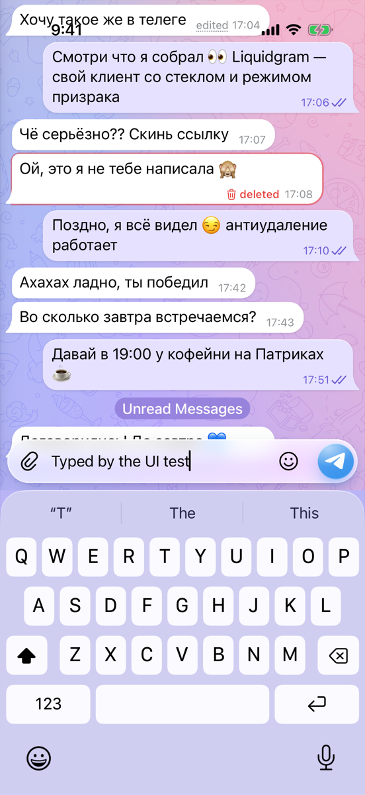

# Liquidgram UI tests

**Passed**: 9 passed, 0 failed, 0 skipped.

- Device: iPhone 17 Pro, iOS 26.2
- Branch: `ios-v2/fix-recorder-native` at `a064afa`
- Run: https://github.com/levaasd142-cmd/liquidgram/actions/runs/40924547013
- Generated: 2026-10-29T17:56:43.145Z

## Tests

| Test | Pass | Status | Duration | Failure |
| --- | --- | --- | --- | --- |
| `CoreTests/testColdStartShowsApiKeysScreen` | light | Passed | 13.3 s |  |
| `CoreTests/testDemoAccount` | light | Passed | 14.7 s |  |
| `CoreTests/testDemoAccountSurvivesRestart` | light | Passed | 19.1 s |  |
| `CoreTests/testKeyboardKeepsFocusedFieldVisible` | light | Passed | 10.2 s |  |
| `CoreTests/testWebAppSelfTest` | light | Passed | 9.8 s |  |
| `RoundVideoTests/testCancelDiscardsRecording` | light | Passed | 14.7 s |  |
| `RoundVideoTests/testRecorderExplainsMissingCamera` | light | Passed | 13.7 s |  |
| `RoundVideoTests/testRecordsAndSendsRoundVideo` | light | Passed | 21.7 s |  |
| `CoreTests/testDemoAccount` | dark | Passed | 20.4 s |  |

## Self-test (light)

| Check | Result | Detail |
| --- | --- | --- |
| `bridge` | ok | version 1.0.0, notification permission default |
| `notificationBridge` | ok | permission default |
| `noServiceWorker` | ok | service workers are unavailable |
| `secureContext` | ok | http://127.0.0.1:47821 |
| `webCrypto` | ok | SHA-256 digest matches |
| `localStorage` | ok | write, read and remove work |
| `indexedDb` | ok | open, put and get work |
| `webAssembly` | ok | a module compiles and runs |
| `worker` | ok | a module worker from the app's origin answered (secure context true) |
| `fetchIndex` | ok | status 200, text/html; charset=utf-8 |
| `rangeRequest` | ok | /assets/index-v9lLG9Y1.js: 206 with bytes 100-1123/159267 |
| `userAgentMobile` | ok | Mozilla/5.0 (iPhone; CPU iPhone OS 18_7 like Mac OS X) AppleWebKit/605.1.15 (KHTML, like Gecko) Mobile/15E148 Liquidgram |
| `userAgentLiquidgram` | ok | Mozilla/5.0 (iPhone; CPU iPhone OS 18_7 like Mac OS X) AppleWebKit/605.1.15 (KHTML, like Gecko) Mobile/15E148 Liquidgram |
| `appRendered` | ok | Transition full-height is-auth |
| `compatTest` | ok | passed |
| `noPageErrors` | ok | none since the page started |

<details><summary>Page details</summary>

```json
{
  "url": "http://127.0.0.1:47821/",
  "userAgent": "Mozilla/5.0 (iPhone; CPU iPhone OS 18_7 like Mac OS X) AppleWebKit/605.1.15 (KHTML, like Gecko) Mobile/15E148 Liquidgram",
  "language": "en-US",
  "viewport": "402x874 at 3x",
  "colorScheme": "light",
  "backdropFilter": true,
  "blobWorker": "blocked: Error: worker error: the script did not load",
  "authScreen": true
}
```

</details>

## Self-test (light)

| Check | Result | Detail |
| --- | --- | --- |
| `roundVideoCancelResult` | ok | null |
| `roundVideoCancelEvents` | ok | presented, cancelled |
| `roundVideoCancelFiles` | ok | 0 files stored |

<details><summary>Page details</summary>

```json
{
  "app": {
    "events": [
      "presented",
      "cancelled"
    ],
    "storedFiles": 0
  },
  "page": {
    "hasRecorder": true,
    "origin": "http://127.0.0.1:47821",
    "pageErrors": [],
    "result": null,
    "secondRequest": null
  }
}
```

</details>

## Self-test (light)

| Check | Result | Detail |
| --- | --- | --- |
| `roundVideoNoCameraResult` | ok | null |

<details><summary>Page details</summary>

```json
{
  "app": {},
  "page": {
    "hasRecorder": true,
    "origin": "http://127.0.0.1:47821",
    "pageErrors": [],
    "result": null,
    "secondRequest": null
  }
}
```

</details>

## Self-test (light)

| Check | Result | Detail |
| --- | --- | --- |
| `roundVideoBridge` | ok | http://127.0.0.1:47821 |
| `roundVideoSecondRequest` | ok | a second request while recording got null |
| `roundVideoPath` | ok | /__liquidgram/media/f260dac70d11c1136c879f3a1e71bc22.mp4 |
| `roundVideoSize` | ok | 480x480 |
| `roundVideoResultDuration` | ok | 9133 ms |
| `roundVideoViewOnce` | ok | true |
| `roundVideoPageErrors` | ok | [] |
| `roundVideoFastStart` | ok | ftyp, moov, mdat |
| `roundVideoVideoTrack` | ok | avc1 480x480 |
| `roundVideoH264High` | ok | profile 100, level 30, CABAC true |
| `roundVideoAudioTrack` | ok | mp4a object type 2, 48000 Hz, 1 channel, 64000 bit/s |
| `roundVideoDuration` | ok | file 9133 ms, page 9133 ms, recorded 9133 ms |
| `roundVideoFrames` | ok | 274 frames in 9.133 s |
| `roundVideoFileSize` | ok | 611109 bytes |
| `roundVideoDecodes` | ok | 480x480 |
| `roundVideoPageFetch` | ok | skipped: http://127.0.0.1:47821 is not served by AppSchemeHandler, fetch gave {"blobType":"text\/plain","contentType":"text\/plain; charset=utf-8","size":9,"status":404} |
| `roundVideoEvents` | ok | presented, sent, released |
| `roundVideoReleased` | ok | 0 files stored after the release |

<details><summary>Page details</summary>

```json
{
  "app": {
    "events": [
      "presented",
      "sent",
      "released"
    ],
    "file": {
      "decodedFrame": "480x480",
      "durationMs": 9133,
      "fastStart": true,
      "recordedDurationMs": 9133,
      "size": 611109,
      "topLevelBoxes": [
        "ftyp",
        "moov",
        "mdat"
      ],
      "tracks": [
        {
          "cabac": true,
          "codec": "avc1",
          "durationMs": 9133,
          "handler": "vide",
          "height": 480,
          "level": 30,
          "profile": 100,
          "samples": 274,
          "width": 480
        },
        {
          "audioObjectType": 2,
          "averageBitRate": 64000,
          "channelConfiguration": 1,
          "channels": 2,
          "codec": "mp4a",
          "durationMs": 9194,
          "handler": "soun",
          "objectTypeIndication": 64,
          "sampleRate": 48000,
          "samples": 431,
          "samplingFrequencyIndex": 3
        }
      ]
    },
    "result": {
      "durationMs": 9133,
      "height": 480,
      "isViewOnce": true,
      "url": "/__liquidgram/media/f260dac70d11c1136c879f3a1e71bc22.mp4",
      "width": 480
    },
    "storedFiles": 0
  },
  "page": {
    "afterRelease": {
      "status": 404
    },
    "fetch": {
      "blobType": "text/plain",
      "contentType": "text/plain; charset=utf-8",
      "size": 9,
      "status": 404
    },
    "hasRecorder": true,
    "origin": "http://127.0.0.1:47821",
    "pageErrors": [],
    "range": {
      "contentRange": null,
      "length": 9,
      "status": 404
    },
    "result": {
      "durationMs": 9133,
      "height": 480,
      "isViewOnce": true,
      "url": "/__liquidgram/media/f260dac70d11c1136c879f3a1e71bc22.mp4",
      "width": 480
    },
    "secondRequest": null
  }
}
```

</details>

Folders: [`screenshots/`](screenshots), [`ax/`](ax) (accessibility trees the tests attached), [`logs/`](logs) (app log, xcodebuild output, self-test reports).

## Screenshots

### `CoreTests/testColdStartShowsApiKeysScreen (light)`


[01-api-keys-screen](screenshots/CoreTests-testColdStartShowsApiKeysScreen-01-api-keys-screen.png)

### `CoreTests/testDemoAccount (light)`




[01-chat-list](screenshots/CoreTests-testDemoAccount-01-chat-list.png) · [02-chat](screenshots/CoreTests-testDemoAccount-02-chat.png) · [03-composer-with-keyboard](screenshots/CoreTests-testDemoAccount-03-composer-with-keyboard.png)

### `CoreTests/testDemoAccountSurvivesRestart (light)`


[01-chat-list-before-restart](screenshots/CoreTests-testDemoAccountSurvivesRestart-01-chat-list-before-restart.png) · [02-chat-list-after-restart](screenshots/CoreTests-testDemoAccountSurvivesRestart-02-chat-list-after-restart.png)

### `CoreTests/testKeyboardKeepsFocusedFieldVisible (light)`


[01-keyboard-up](screenshots/CoreTests-testKeyboardKeepsFocusedFieldVisible-01-keyboard-up.png)

### `CoreTests/testWebAppSelfTest (light)`


[01-self-test-finished](screenshots/CoreTests-testWebAppSelfTest-01-self-test-finished.png)

### `RoundVideoTests/testCancelDiscardsRecording (light)`


[01-recording](screenshots/RoundVideoTests-testCancelDiscardsRecording-01-recording.png) · [02-after-cancel](screenshots/RoundVideoTests-testCancelDiscardsRecording-02-after-cancel.png)

### `RoundVideoTests/testRecorderExplainsMissingCamera (light)`


[01-no-camera](screenshots/RoundVideoTests-testRecorderExplainsMissingCamera-01-no-camera.png)

### `RoundVideoTests/testRecordsAndSendsRoundVideo (light)`


[01-recording](screenshots/RoundVideoTests-testRecordsAndSendsRoundVideo-01-recording.png) · [02-screen-flash](screenshots/RoundVideoTests-testRecordsAndSendsRoundVideo-02-screen-flash.png) · [03-back-camera-view-once](screenshots/RoundVideoTests-testRecordsAndSendsRoundVideo-03-back-camera-view-once.png) · [04-after-send](screenshots/RoundVideoTests-testRecordsAndSendsRoundVideo-04-after-send.png)

### `CoreTests/testDemoAccount (dark)`


[01-chat-list-dark](screenshots/CoreTests-testDemoAccount-01-chat-list-dark.png) · [02-chat-dark](screenshots/CoreTests-testDemoAccount-02-chat-dark.png) · [03-composer-with-keyboard-dark](screenshots/CoreTests-testDemoAccount-03-composer-with-keyboard-dark.png)

