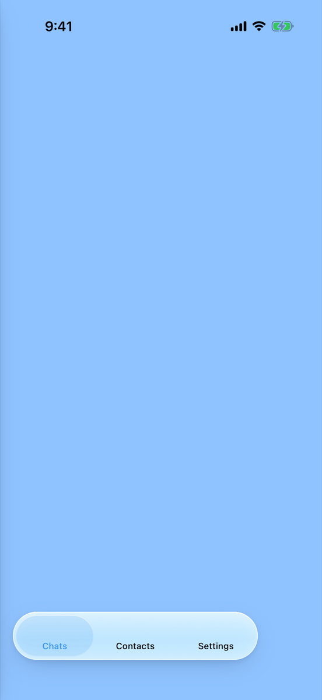

# Liquidgram UI tests

**Failed**: 17 passed, 3 failed, 1 skipped.

- Device: iPhone 17 Pro, iOS 26.2
- Branch: `ios-v2/fix-transport` at `f156914`
- Run: https://github.com/levaasd142-cmd/liquidgram/actions/runs/40926033859
- Generated: 2026-10-29T18:06:40.773Z

## Tests

| Test | Pass | Status | Duration | Failure |
| --- | --- | --- | --- | --- |
| `TransportTests/testLegacyDataMovesToAppOrigin` | migration | Passed | 15.0 s |  |
| `CoreTests/testColdStartShowsApiKeysScreen` | light | Passed | 14.0 s |  |
| `CoreTests/testDemoAccount` | light | Passed | 15.0 s |  |
| `CoreTests/testDemoAccountSurvivesRestart` | light | Passed | 18.2 s |  |
| `CoreTests/testKeyboardKeepsFocusedFieldVisible` | light | Passed | 6.5 s |  |
| `CoreTests/testWebAppSelfTest` | light | Passed | 9.0 s |  |
| `FeatureTests/testAppLockOpensAndLocksAgainAfterBackground` | light | Passed | 19.3 s |  |
| `FeatureTests/testAppLockStaysLockedWhenAuthenticationFails` | light | Passed | 13.0 s |  |
| `FeatureTests/testChatHeaderStaysVisibleWhileTyping` | light | Failed | 10.6 s | FeatureTests.swift:286: XCTAssertTrue failed - The chat header (114.0, -324.0, 121.0, 24.0) left the screen while typing; the status bar ends at y 54.0 |
| `FeatureTests/testDeepLinkOpensSettings` | light | Passed | 10.0 s |  |
| `FeatureTests/testHeadersStayBelowStatusBar` | light | Failed | 6.8 s | FeatureTests.swift:267: XCTAssertTrue failed - Under the status bar, which ends at y 54.0: the chat list header starts at y 12.0; the chat header starts at y 11.0 |
| `FeatureTests/testKeyboardHasNoFormToolbar` | light | Passed | 8.4 s |  |
| `FeatureTests/testLiquidgramSettingsShowIPhoneSection` | light | Passed | 11.5 s |  |
| `FeatureTests/testPrivacyShieldCoversAppWhileInactive` | light | Passed | 13.5 s |  |
| `FeatureTests/testQuickActionFocusesSearch` | light | Failed | 44.3 s | FeatureTests.swift:168: failed - Not found within 40 s: the keyboard of the focused search |
| `FeatureTests/testQuickActionOpensNewMessage` | light | Passed | 5.0 s |  |
| `FeatureTests/testQuickActionOpensSavedMessages` | light | Passed | 5.1 s |  |
| `FeatureTests/testQuickActionTogglesGhostMode` | light | Passed | 4.9 s |  |
| `TransportTests/testLegacyDataMovesToAppOrigin` | light | Skipped | 0.0 s | Test skipped - Needs the data of the loopback version; run-ui-tests.sh seeds it with UI_TESTS_LEGACY_REF |
| `TransportTests/testMediaStreamsFromPage` | light | Passed | 9.4 s |  |
| `CoreTests/testDemoAccount` | dark | Passed | 17.6 s |  |

## Self-test (migration)

| Check | Result | Detail |
| --- | --- | --- |
| `appOrigin` | ok | liquidgram-web://app |
| `migrationOutcome` | ok | moved 5 localStorage items, 3 IndexedDB records, 0 left out, 30179 bytes |
| `apiCredentials` | ok | the API keys of the loopback version |
| `session` | ok | account1 of user 100000 on DC 2 |
| `marker` | ok | the localStorage marker of legacy-seed.js |
| `typedValues` | ok | Blob, ArrayBuffer, Int16Array, Date, BigInt, Map, Set, undefined and NaN |
| `cachedState` | ok | the cached state with 8 chats |

<details><summary>Page details</summary>

```json
{
  "url": "liquidgram-web://app/",
  "localStorageKeys": [
    "account1",
    "lg-api-credentials",
    "liquidgram-test-legacy-marker",
    "tt-last-activity",
    "tt-multitab_1"
  ]
}
```

</details>

## Self-test (light)

| Check | Result | Detail |
| --- | --- | --- |
| `bridge` | ok | version 1.0.0, notification permission default |
| `notificationBridge` | ok | permission default |
| `noServiceWorker` | ok | service workers are unavailable |
| `appOrigin` | ok | liquidgram-web://app |
| `secureContext` | ok | liquidgram-web://app |
| `webCrypto` | ok | SHA-256 digest matches |
| `localStorage` | ok | write, read and remove work |
| `indexedDb` | ok | open, put and get work |
| `webAssembly` | ok | a module compiles and runs |
| `worker` | ok | a module worker from the app's origin answered (secure context true) |
| `fetchIndex` | ok | status 200, text/html; charset=utf-8 |
| `rangeRequest` | ok | /assets/index-CM-eP7_t.js: 206 with bytes 100-1123/159267 |
| `userAgentMobile` | ok | Mozilla/5.0 (iPhone; CPU iPhone OS 18_7 like Mac OS X) AppleWebKit/605.1.15 (KHTML, like Gecko) Mobile/15E148 Liquidgram |
| `userAgentLiquidgram` | ok | Mozilla/5.0 (iPhone; CPU iPhone OS 18_7 like Mac OS X) AppleWebKit/605.1.15 (KHTML, like Gecko) Mobile/15E148 Liquidgram |
| `appRendered` | ok | Transition full-height is-auth |
| `compatTest` | ok | passed |
| `noPageErrors` | ok | none since the page started |

<details><summary>Page details</summary>

```json
{
  "url": "liquidgram-web://app/",
  "userAgent": "Mozilla/5.0 (iPhone; CPU iPhone OS 18_7 like Mac OS X) AppleWebKit/605.1.15 (KHTML, like Gecko) Mobile/15E148 Liquidgram",
  "language": "en-US",
  "viewport": "402x874 at 3x",
  "colorScheme": "light",
  "backdropFilter": true,
  "blobWorker": "blocked: Error: worker error: the script did not load",
  "authScreen": true
}
```

</details>

## Self-test (light)

| Check | Result | Detail |
| --- | --- | --- |
| `appOrigin` | ok | liquidgram-web://app |
| `loadMediaPartRegistered` | ok | the web app set `window.__liquidgramNative.loadMediaPart` |
| `webAppChain` | ok | played in 694 ms, seeked in 398 ms and played to 2.36 s of 3 s; the web app downloaded parts 0, 3 of 4 |
| `probeRange` | ok | 206 bytes 0-1, video/mp4, nosniff, sandbox |
| `openRange` | ok | 206 with the first 524288 bytes |
| `unalignedRanges` | ok | across a part boundary and at the end of the file |
| `suffixRanges` | ok | with and without the size in the URL |
| `beyondEnd` | ok | 416 with bytes */1300000 |
| `wholeFile` | ok | GET without a range is 200 with every part in order; HEAD gives the size |
| `parallelRanges` | ok | 12 requests, at most 4 parts loading at once |
| `contentTypeGuard` | ok | text/html is served as application/octet-stream in a sandbox |
| `failedPart` | ok | the request failed (TypeError: Load failed), the next one worked |
| `abortedFetch` | ok | a request stopped while streaming leaves the stream working |
| `audioStreamsAndSeeks` | ok | played in 1270 ms, seeked in 622 ms and played to 24.24 s of 30 s; 2 of 6 parts were in when it started |
| `videoPlaysAndSeeks` | ok | played in 429 ms, seeked in 367 ms and played to 2.39 s of 3 s; parts 0, 3 of 4 were asked for |

<details><summary>Page details</summary>

```json
{
  "migrationOutcome": "nothing to move",
  "webAppChain": {
    "playingMs": 694,
    "duration": 3,
    "seekedMs": 398,
    "playedTo": 2.36,
    "parts": [
      0,
      3
    ]
  },
  "audio": {
    "playingMs": 1270,
    "partsBeforePlaying": 2,
    "duration": 30,
    "seekedMs": 622,
    "playedTo": 24.24,
    "requestedParts": [
      0,
      4,
      5
    ],
    "totalParts": 6,
    "seekPart": 4
  },
  "video": {
    "playingMs": 429,
    "partsBeforePlaying": 1,
    "duration": 3,
    "seekedMs": 367,
    "playedTo": 2.39,
    "requestedParts": [
      0,
      3
    ]
  }
}
```

</details>

Folders: [`screenshots/`](screenshots), [`ax/`](ax) (accessibility trees the tests attached), [`logs/`](logs) (app log, xcodebuild output, self-test reports).

## Screenshots

### `TransportTests/testLegacyDataMovesToAppOrigin (migration)`



[01-chats-after-migration](screenshots/TransportTests-testLegacyDataMovesToAppOrigin-01-chats-after-migration.png)

### `CoreTests/testColdStartShowsApiKeysScreen (light)`


[01-api-keys-screen](screenshots/CoreTests-testColdStartShowsApiKeysScreen-01-api-keys-screen.png)

### `CoreTests/testDemoAccount (light)`


[01-chat-list](screenshots/CoreTests-testDemoAccount-01-chat-list.png) · [02-chat](screenshots/CoreTests-testDemoAccount-02-chat.png) · [03-composer-with-keyboard](screenshots/CoreTests-testDemoAccount-03-composer-with-keyboard.png)

### `CoreTests/testDemoAccountSurvivesRestart (light)`


[01-chat-list-before-restart](screenshots/CoreTests-testDemoAccountSurvivesRestart-01-chat-list-before-restart.png) · [02-chat-list-after-restart](screenshots/CoreTests-testDemoAccountSurvivesRestart-02-chat-list-after-restart.png)

### `CoreTests/testKeyboardKeepsFocusedFieldVisible (light)`


[01-keyboard-up](screenshots/CoreTests-testKeyboardKeepsFocusedFieldVisible-01-keyboard-up.png)

### `CoreTests/testWebAppSelfTest (light)`


[01-self-test-finished](screenshots/CoreTests-testWebAppSelfTest-01-self-test-finished.png)

### `FeatureTests/testAppLockOpensAndLocksAgainAfterBackground (light)`


[01-locked-at-launch](screenshots/FeatureTests-testAppLockOpensAndLocksAgainAfterBackground-01-locked-at-launch.png) · [02-unlocked](screenshots/FeatureTests-testAppLockOpensAndLocksAgainAfterBackground-02-unlocked.png) · [03-locked-after-background](screenshots/FeatureTests-testAppLockOpensAndLocksAgainAfterBackground-03-locked-after-background.png) · [04-unlocked-again](screenshots/FeatureTests-testAppLockOpensAndLocksAgainAfterBackground-04-unlocked-again.png)

### `FeatureTests/testAppLockStaysLockedWhenAuthenticationFails (light)`


[01-failed-authentication](screenshots/FeatureTests-testAppLockStaysLockedWhenAuthenticationFails-01-failed-authentication.png) · [02-failed-again](screenshots/FeatureTests-testAppLockStaysLockedWhenAuthenticationFails-02-failed-again.png)

### `FeatureTests/testChatHeaderStaysVisibleWhileTyping (light)`


[01-typing](screenshots/FeatureTests-testChatHeaderStaysVisibleWhileTyping-01-typing.png)

### `FeatureTests/testDeepLinkOpensSettings (light)`


[01-settings-from-deep-link](screenshots/FeatureTests-testDeepLinkOpensSettings-01-settings-from-deep-link.png)

### `FeatureTests/testHeadersStayBelowStatusBar (light)`


[01-chat-list-header](screenshots/FeatureTests-testHeadersStayBelowStatusBar-01-chat-list-header.png) · [02-chat-header](screenshots/FeatureTests-testHeadersStayBelowStatusBar-02-chat-header.png)

### `FeatureTests/testKeyboardHasNoFormToolbar (light)`


[01-keyboard](screenshots/FeatureTests-testKeyboardHasNoFormToolbar-01-keyboard.png)

### `FeatureTests/testLiquidgramSettingsShowIPhoneSection (light)`


[01-liquidgram-settings](screenshots/FeatureTests-testLiquidgramSettingsShowIPhoneSection-01-liquidgram-settings.png) · [02-iphone-section](screenshots/FeatureTests-testLiquidgramSettingsShowIPhoneSection-02-iphone-section.png)

### `FeatureTests/testPrivacyShieldCoversAppWhileInactive (light)`


[01-shield-under-notification-center](screenshots/FeatureTests-testPrivacyShieldCoversAppWhileInactive-01-shield-under-notification-center.png) · [02-shield-removed](screenshots/FeatureTests-testPrivacyShieldCoversAppWhileInactive-02-shield-removed.png) · [03-app-switcher](screenshots/FeatureTests-testPrivacyShieldCoversAppWhileInactive-03-app-switcher.png)

### `FeatureTests/testQuickActionFocusesSearch (light)`


[failure-the-keyboard-of-the-focused-search](screenshots/FeatureTests-testQuickActionFocusesSearch-failure-the-keyboard-of-the-focused-search.png)

### `FeatureTests/testQuickActionOpensNewMessage (light)`


[01-new-message](screenshots/FeatureTests-testQuickActionOpensNewMessage-01-new-message.png)

### `FeatureTests/testQuickActionOpensSavedMessages (light)`


[01-saved-messages](screenshots/FeatureTests-testQuickActionOpensSavedMessages-01-saved-messages.png)

### `FeatureTests/testQuickActionTogglesGhostMode (light)`


[01-ghost-mode-toast](screenshots/FeatureTests-testQuickActionTogglesGhostMode-01-ghost-mode-toast.png)

### `TransportTests/testMediaStreamsFromPage (light)`


[01-stream-check-finished](screenshots/TransportTests-testMediaStreamsFromPage-01-stream-check-finished.png)

### `CoreTests/testDemoAccount (dark)`


[01-chat-list-dark](screenshots/CoreTests-testDemoAccount-01-chat-list-dark.png) · [02-chat-dark](screenshots/CoreTests-testDemoAccount-02-chat-dark.png) · [03-composer-with-keyboard-dark](screenshots/CoreTests-testDemoAccount-03-composer-with-keyboard-dark.png)

