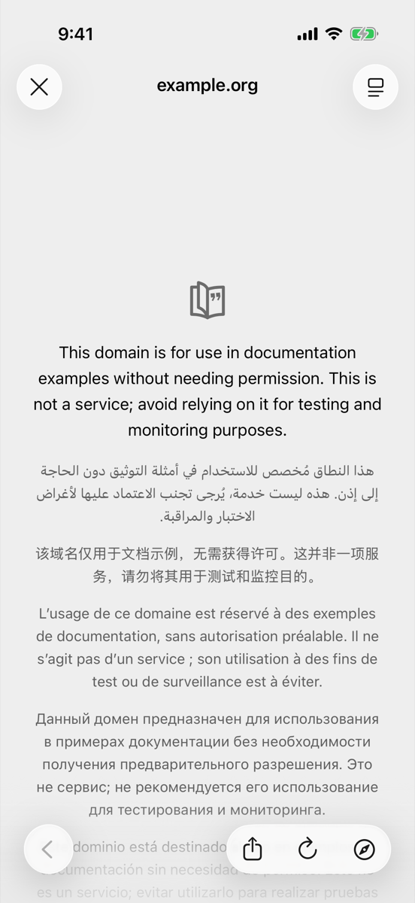
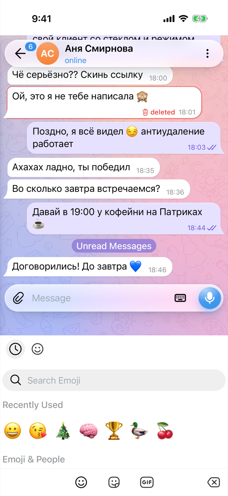
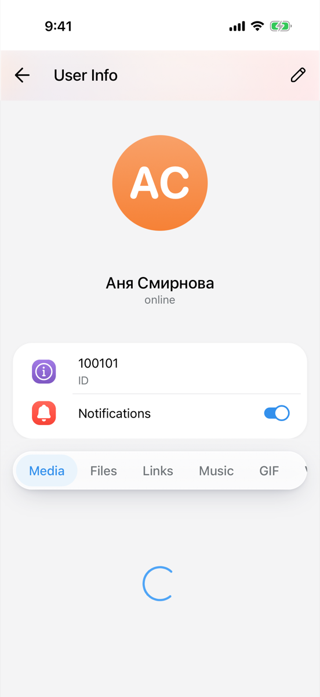
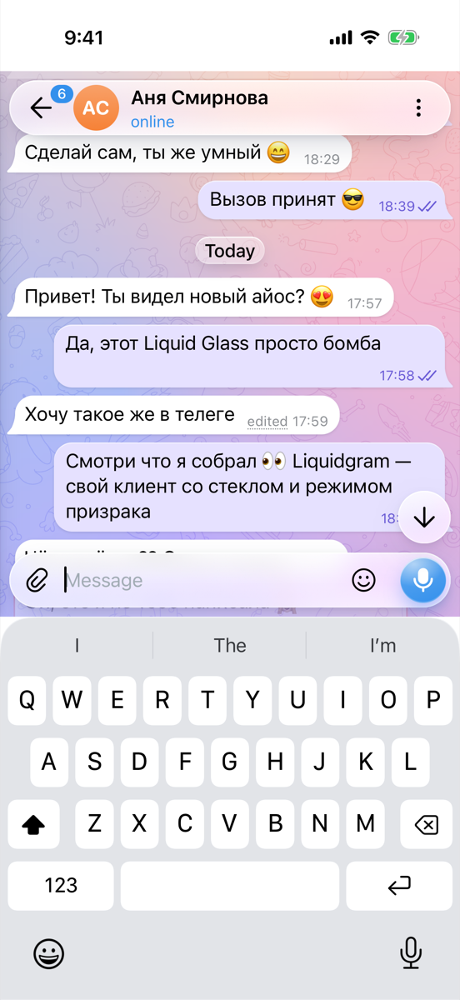

# Liquidgram UI tests

**Failed**: 30 passed, 3 failed, 0 skipped.

- Device: iPhone 17 Pro, iOS 26.2
- Branch: `ios-v2-scratch/native-shell-usability` at `8936934`
- Run: https://github.com/levaasd142-cmd/liquidgram/actions/runs/40931366357
- Generated: 2026-10-29T18:57:16.539Z

## Tests

| Test | Pass | Status | Duration | Failure |
| --- | --- | --- | --- | --- |
| `CoreTests/testColdStartShowsApiKeysScreen` | light | Passed | 37.0 s |  |
| `CoreTests/testDemoAccount` | light | Passed | 31.0 s |  |
| `CoreTests/testDemoAccountSurvivesRestart` | light | Passed | 40.0 s |  |
| `CoreTests/testKeyboardKeepsFocusedFieldVisible` | light | Passed | 34.5 s |  |
| `CoreTests/testWebAppSelfTest` | light | Passed | 12.8 s |  |
| `FeatureTests/testAppLockOpensAndLocksAgainAfterBackground` | light | Passed | 23.8 s |  |
| `FeatureTests/testAppLockStaysLockedWhenAuthenticationFails` | light | Passed | 19.6 s |  |
| `FeatureTests/testDeepLinkOpensSettings` | light | Passed | 33.9 s |  |
| `FeatureTests/testKeyboardHasNoFormToolbar` | light | Passed | 16.6 s |  |
| `FeatureTests/testLiquidgramSettingsShowIPhoneSection` | light | Passed | 19.7 s |  |
| `FeatureTests/testPrivacyShieldCoversAppWhileInactive` | light | Passed | 25.6 s |  |
| `FeatureTests/testQuickActionFocusesSearch` | light | Passed | 46.1 s |  |
| `FeatureTests/testQuickActionOpensNewMessage` | light | Passed | 10.2 s |  |
| `FeatureTests/testQuickActionOpensSavedMessages` | light | Passed | 12.9 s |  |
| `FeatureTests/testQuickActionTogglesGhostMode` | light | Passed | 11.2 s |  |
| `ShellTests/testIPhoneStaysInPortrait` | light | Passed | 12.4 s |  |
| `ShellTests/testKeyboardResizesPageAndRestoresIt` | light | Passed | 29.3 s |  |
| `ShellTests/testWindowOpenedLateShowsInAppBrowser` | light | Passed | 40.7 s |  |
| `UsabilityTests/testAppStaysPortrait` | light | Passed | 21.9 s |  |
| `UsabilityTests/testAttachMenuAndEmojiPanelFitOnScreen` | light | Failed | 65.2 s | UsabilityTests.swift:625: failed - The panels of the composer: The Emoji tab of the emoji panel at (126, 833, 34×34) is not entirely between the status bar and y 840; The Stickers tab of the emoji panel at (184, 833, 34×34) is not entirely between the status bar and y 840; The GIFs tab of the emoji panel at (242, 833, 34×34) is not entirely between the status bar and y 840 |
| `UsabilityTests/testChatListTopRowWorks` | light | Passed | 30.1 s |  |
| `UsabilityTests/testChatTopRowWorks` | light | Passed | 36.4 s |  |
| `UsabilityTests/testDelayedWindowOpenShowsInAppBrowser` | light | Passed | 22.2 s |  |
| `UsabilityTests/testDraggingMessagesHidesKeyboard` | light | Failed | 31.6 s | UsabilityTests.swift:468: failed - The keyboard stayed up after a drag down on the messages from y 225 to y 425 |
| `UsabilityTests/testKeyboardKeepsChatLayout` | light | Failed | 41.0 s | UsabilityTests.swift:443: failed - The chat with the keyboard: The page scrolled during the keyboard cycles: highest pageTop 0.0, offsetTop 335.0, scrollTop 0.0, scrollY 0.0 |
| `UsabilityTests/testLongPressOnMessageOpensMenu` | light | Passed | 63.6 s |  |
| `UsabilityTests/testMediaViewerOpensAndCloses` | light | Passed | 21.1 s |  |
| `UsabilityTests/testPageIsActiveBeforeFirstTap` | light | Passed | 14.2 s |  |
| `UsabilityTests/testProfileTopRowWorks` | light | Passed | 29.5 s |  |
| `UsabilityTests/testSettingsTopRowWorks` | light | Passed | 31.6 s |  |
| `UsabilityTests/testStatusBarStripMatchesTheme` | light | Passed | 11.9 s |  |
| `CoreTests/testDemoAccount` | dark | Passed | 41.7 s |  |
| `UsabilityTests/testStatusBarStripMatchesTheme` | dark | Passed | 16.4 s |  |

## Self-test (light)

| Check | Result | Detail |
| --- | --- | --- |
| `bridge` | ok | version 1.0.0, notification permission default |
| `notificationBridge` | ok | permission default |
| `noServiceWorker` | ok | service workers are unavailable |
| `secureContext` | ok | http://127.0.0.1:47821 |
| `webCrypto` | ok | SHA-256 digest matches |
| `localStorage` | ok | write, read and remove work |
| `indexedDb` | ok | open, put and get work |
| `webAssembly` | ok | a module compiles and runs |
| `worker` | ok | a module worker from the app's origin answered (secure context true) |
| `fetchIndex` | ok | status 200, text/html; charset=utf-8 |
| `rangeRequest` | ok | /assets/index-B4-Me6xY.js: 206 with bytes 100-1123/159267 |
| `userAgentMobile` | ok | Mozilla/5.0 (iPhone; CPU iPhone OS 18_7 like Mac OS X) AppleWebKit/605.1.15 (KHTML, like Gecko) Mobile/15E148 Liquidgram |
| `userAgentLiquidgram` | ok | Mozilla/5.0 (iPhone; CPU iPhone OS 18_7 like Mac OS X) AppleWebKit/605.1.15 (KHTML, like Gecko) Mobile/15E148 Liquidgram |
| `appRendered` | ok | Transition full-height is-auth |
| `compatTest` | ok | passed |
| `noPageErrors` | ok | none since the page started |

<details><summary>Page details</summary>

```json
{
  "url": "http://127.0.0.1:47821/",
  "userAgent": "Mozilla/5.0 (iPhone; CPU iPhone OS 18_7 like Mac OS X) AppleWebKit/605.1.15 (KHTML, like Gecko) Mobile/15E148 Liquidgram",
  "language": "en-US",
  "viewport": "402x812 at 3x",
  "colorScheme": "light",
  "backdropFilter": true,
  "blobWorker": "blocked: Error: worker error: the script did not load",
  "authScreen": true
}
```

</details>

Folders: [`screenshots/`](screenshots), [`ax/`](ax) (accessibility trees of failed tests), [`logs/`](logs) (app log, xcodebuild output, self-test reports).

## Screenshots

All screenshots at a glance, with a band for the test's result: green passed, red failed, orange the moment of the failure.


### `CoreTests/testColdStartShowsApiKeysScreen (light)`


[01-api-keys-screen](screenshots/CoreTests-testColdStartShowsApiKeysScreen-01-api-keys-screen.png)

### `CoreTests/testDemoAccount (light)`


[01-chat-list](screenshots/CoreTests-testDemoAccount-01-chat-list.png) · [02-chat](screenshots/CoreTests-testDemoAccount-02-chat.png) · [03-composer-with-keyboard](screenshots/CoreTests-testDemoAccount-03-composer-with-keyboard.png)

### `CoreTests/testDemoAccountSurvivesRestart (light)`


[01-chat-list-before-restart](screenshots/CoreTests-testDemoAccountSurvivesRestart-01-chat-list-before-restart.png) · [02-chat-list-after-restart](screenshots/CoreTests-testDemoAccountSurvivesRestart-02-chat-list-after-restart.png)

### `CoreTests/testKeyboardKeepsFocusedFieldVisible (light)`


[01-keyboard-up](screenshots/CoreTests-testKeyboardKeepsFocusedFieldVisible-01-keyboard-up.png)

### `CoreTests/testWebAppSelfTest (light)`


[01-self-test-finished](screenshots/CoreTests-testWebAppSelfTest-01-self-test-finished.png)

### `FeatureTests/testAppLockOpensAndLocksAgainAfterBackground (light)`


[01-locked-at-launch](screenshots/FeatureTests-testAppLockOpensAndLocksAgainAfterBackground-01-locked-at-launch.png) · [02-unlocked](screenshots/FeatureTests-testAppLockOpensAndLocksAgainAfterBackground-02-unlocked.png) · [03-locked-after-background](screenshots/FeatureTests-testAppLockOpensAndLocksAgainAfterBackground-03-locked-after-background.png) · [04-unlocked-again](screenshots/FeatureTests-testAppLockOpensAndLocksAgainAfterBackground-04-unlocked-again.png)

### `FeatureTests/testAppLockStaysLockedWhenAuthenticationFails (light)`


[01-failed-authentication](screenshots/FeatureTests-testAppLockStaysLockedWhenAuthenticationFails-01-failed-authentication.png) · [02-failed-again](screenshots/FeatureTests-testAppLockStaysLockedWhenAuthenticationFails-02-failed-again.png)

### `FeatureTests/testDeepLinkOpensSettings (light)`


[01-settings-from-deep-link](screenshots/FeatureTests-testDeepLinkOpensSettings-01-settings-from-deep-link.png)

### `FeatureTests/testKeyboardHasNoFormToolbar (light)`


[01-keyboard](screenshots/FeatureTests-testKeyboardHasNoFormToolbar-01-keyboard.png)

### `FeatureTests/testLiquidgramSettingsShowIPhoneSection (light)`


[01-liquidgram-settings](screenshots/FeatureTests-testLiquidgramSettingsShowIPhoneSection-01-liquidgram-settings.png) · [02-iphone-section](screenshots/FeatureTests-testLiquidgramSettingsShowIPhoneSection-02-iphone-section.png)

### `FeatureTests/testPrivacyShieldCoversAppWhileInactive (light)`


[01-shield-under-notification-center](screenshots/FeatureTests-testPrivacyShieldCoversAppWhileInactive-01-shield-under-notification-center.png) · [02-shield-removed](screenshots/FeatureTests-testPrivacyShieldCoversAppWhileInactive-02-shield-removed.png) · [03-app-switcher](screenshots/FeatureTests-testPrivacyShieldCoversAppWhileInactive-03-app-switcher.png)

### `FeatureTests/testQuickActionFocusesSearch (light)`


[01-search-focused](screenshots/FeatureTests-testQuickActionFocusesSearch-01-search-focused.png)

### `FeatureTests/testQuickActionOpensNewMessage (light)`


[01-new-message](screenshots/FeatureTests-testQuickActionOpensNewMessage-01-new-message.png)

### `FeatureTests/testQuickActionOpensSavedMessages (light)`


[01-saved-messages](screenshots/FeatureTests-testQuickActionOpensSavedMessages-01-saved-messages.png)

### `FeatureTests/testQuickActionTogglesGhostMode (light)`


[01-ghost-mode-toast](screenshots/FeatureTests-testQuickActionTogglesGhostMode-01-ghost-mode-toast.png)

### `ShellTests/testIPhoneStaysInPortrait (light)`


[01-turned-sideways](screenshots/ShellTests-testIPhoneStaysInPortrait-01-turned-sideways.png)

### `ShellTests/testKeyboardResizesPageAndRestoresIt (light)`


[01-chat-list](screenshots/ShellTests-testKeyboardResizesPageAndRestoresIt-01-chat-list.png) · [02-chat](screenshots/ShellTests-testKeyboardResizesPageAndRestoresIt-02-chat.png) · [03-keyboard-up](screenshots/ShellTests-testKeyboardResizesPageAndRestoresIt-03-keyboard-up.png) · [04-keyboard-hidden](screenshots/ShellTests-testKeyboardResizesPageAndRestoresIt-04-keyboard-hidden.png)

### `ShellTests/testWindowOpenedLateShowsInAppBrowser (light)`



[01-in-app-browser](screenshots/ShellTests-testWindowOpenedLateShowsInAppBrowser-01-in-app-browser.png)

### `UsabilityTests/testAppStaysPortrait (light)`


[01-portrait](screenshots/UsabilityTests-testAppStaysPortrait-01-portrait.png) · [02-device-turned](screenshots/UsabilityTests-testAppStaysPortrait-02-device-turned.png)

### `UsabilityTests/testAttachMenuAndEmojiPanelFitOnScreen (light)`




[01-attach-menu](screenshots/UsabilityTests-testAttachMenuAndEmojiPanelFitOnScreen-01-attach-menu.png) · [02-emoji-panel](screenshots/UsabilityTests-testAttachMenuAndEmojiPanelFitOnScreen-02-emoji-panel.png) · [failure-the-panels-of-the-composer-the-emoji-tab-of-the](screenshots/UsabilityTests-testAttachMenuAndEmojiPanelFitOnScreen-failure-the-panels-of-the-composer-the-emoji-tab-of-the.png)

### `UsabilityTests/testChatListTopRowWorks (light)`


[01-chat-list](screenshots/UsabilityTests-testChatListTopRowWorks-01-chat-list.png) · [02-main-menu](screenshots/UsabilityTests-testChatListTopRowWorks-02-main-menu.png) · [03-search](screenshots/UsabilityTests-testChatListTopRowWorks-03-search.png) · [04-ghost-mode](screenshots/UsabilityTests-testChatListTopRowWorks-04-ghost-mode.png)

### `UsabilityTests/testChatTopRowWorks (light)`





[01-chat](screenshots/UsabilityTests-testChatTopRowWorks-01-chat.png) · [02-chat-menu](screenshots/UsabilityTests-testChatTopRowWorks-02-chat-menu.png) · [03-profile](screenshots/UsabilityTests-testChatTopRowWorks-03-profile.png) · [04-chat-list-after-back](screenshots/UsabilityTests-testChatTopRowWorks-04-chat-list-after-back.png)

### `UsabilityTests/testDelayedWindowOpenShowsInAppBrowser (light)`


[01-in-app-browser](screenshots/UsabilityTests-testDelayedWindowOpenShowsInAppBrowser-01-in-app-browser.png)

### `UsabilityTests/testDraggingMessagesHidesKeyboard (light)`




[01-keyboard-up](screenshots/UsabilityTests-testDraggingMessagesHidesKeyboard-01-keyboard-up.png) · [02-after-drag](screenshots/UsabilityTests-testDraggingMessagesHidesKeyboard-02-after-drag.png) · [failure-the-keyboard-stayed-up-after-a-drag-down-on-the](screenshots/UsabilityTests-testDraggingMessagesHidesKeyboard-failure-the-keyboard-stayed-up-after-a-drag-down-on-the.png)

### `UsabilityTests/testKeyboardKeepsChatLayout (light)`


[01-chat](screenshots/UsabilityTests-testKeyboardKeepsChatLayout-01-chat.png) · [02-keyboard](screenshots/UsabilityTests-testKeyboardKeepsChatLayout-02-keyboard.png) · [03-keyboard-hidden](screenshots/UsabilityTests-testKeyboardKeepsChatLayout-03-keyboard-hidden.png) · [04-after-keyboard-cycles](screenshots/UsabilityTests-testKeyboardKeepsChatLayout-04-after-keyboard-cycles.png) · [failure-the-chat-with-the-keyboard-the-page-scrolled](screenshots/UsabilityTests-testKeyboardKeepsChatLayout-failure-the-chat-with-the-keyboard-the-page-scrolled.png)

### `UsabilityTests/testLongPressOnMessageOpensMenu (light)`


[01-message-menu](screenshots/UsabilityTests-testLongPressOnMessageOpensMenu-01-message-menu.png) · [02-reply](screenshots/UsabilityTests-testLongPressOnMessageOpensMenu-02-reply.png)

### `UsabilityTests/testMediaViewerOpensAndCloses (light)`


[01-chat-with-photo](screenshots/UsabilityTests-testMediaViewerOpensAndCloses-01-chat-with-photo.png) · [02-media-viewer](screenshots/UsabilityTests-testMediaViewerOpensAndCloses-02-media-viewer.png) · [03-media-viewer-closed](screenshots/UsabilityTests-testMediaViewerOpensAndCloses-03-media-viewer-closed.png)

### `UsabilityTests/testPageIsActiveBeforeFirstTap (light)`


[01-chat-list-untouched](screenshots/UsabilityTests-testPageIsActiveBeforeFirstTap-01-chat-list-untouched.png)

### `UsabilityTests/testProfileTopRowWorks (light)`


[01-profile](screenshots/UsabilityTests-testProfileTopRowWorks-01-profile.png) · [02-edit-contact](screenshots/UsabilityTests-testProfileTopRowWorks-02-edit-contact.png) · [03-chat-after-back](screenshots/UsabilityTests-testProfileTopRowWorks-03-chat-after-back.png)

### `UsabilityTests/testSettingsTopRowWorks (light)`


[01-settings](screenshots/UsabilityTests-testSettingsTopRowWorks-01-settings.png) · [02-settings-menu](screenshots/UsabilityTests-testSettingsTopRowWorks-02-settings-menu.png) · [03-settings-search](screenshots/UsabilityTests-testSettingsTopRowWorks-03-settings-search.png) · [04-edit-profile](screenshots/UsabilityTests-testSettingsTopRowWorks-04-edit-profile.png) · [05-chat-list](screenshots/UsabilityTests-testSettingsTopRowWorks-05-chat-list.png)

### `UsabilityTests/testStatusBarStripMatchesTheme (light)`


[01-status-bar-strip](screenshots/UsabilityTests-testStatusBarStripMatchesTheme-01-status-bar-strip.png)

### `CoreTests/testDemoAccount (dark)`


[01-chat-list-dark](screenshots/CoreTests-testDemoAccount-01-chat-list-dark.png) · [02-chat-dark](screenshots/CoreTests-testDemoAccount-02-chat-dark.png) · [03-composer-with-keyboard-dark](screenshots/CoreTests-testDemoAccount-03-composer-with-keyboard-dark.png)

### `UsabilityTests/testStatusBarStripMatchesTheme (dark)`


[01-status-bar-strip-dark](screenshots/UsabilityTests-testStatusBarStripMatchesTheme-01-status-bar-strip-dark.png)

