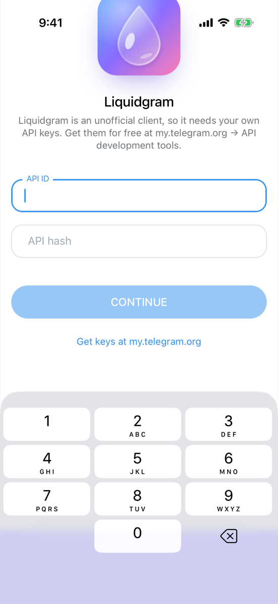

# Liquidgram UI tests

**Failed**: 13 passed, 4 failed, 0 skipped.

- Device: iPhone 17 Pro, iOS 26.2
- Branch: `ios-v2/integration` at `2f470e9`
- Run: https://github.com/levaasd142-cmd/liquidgram/actions/runs/40905720998
- Generated: 2026-10-29T15:59:52.785Z

## Tests

| Test | Pass | Status | Duration | Failure |
| --- | --- | --- | --- | --- |
| `CoreTests/testColdStartShowsApiKeysScreen` | light | Passed | 13.7 s |  |
| `CoreTests/testDemoAccount` | light | Passed | 15.4 s |  |
| `CoreTests/testKeyboardKeepsFocusedFieldVisible` | light | Passed | 6.9 s |  |
| `CoreTests/testWebAppSelfTest` | light | Passed | 9.7 s |  |
| `FeatureTests/testAppLockOpensAndLocksAgainAfterBackground` | light | Failed | 14.6 s | FeatureTests.swift:63: failed - Not found within 10 s: the lock screen at launch |
| `FeatureTests/testAppLockStaysLockedWhenAuthenticationFails` | light | Passed | 13.0 s |  |
| `FeatureTests/testChatHeaderStaysVisibleWhileTyping` | light | Failed | 11.5 s | FeatureTests.swift:290: XCTAssertTrue failed - The chat header (114.0, -324.0, 121.0, 24.0) left the screen while typing; the status bar ends at y 54.0 |
| `FeatureTests/testDeepLinkOpensSettings` | light | Passed | 10.6 s |  |
| `FeatureTests/testHeadersStayBelowStatusBar` | light | Failed | 8.4 s | FeatureTests.swift:270: XCTAssertTrue failed - Under the status bar, which ends at y 54.0: the chat list header starts at y 12.0; the chat header starts at y 11.0 |
| `FeatureTests/testKeyboardHasNoFormToolbar` | light | Passed | 8.5 s |  |
| `FeatureTests/testLiquidgramSettingsShowIPhoneSection` | light | Passed | 11.2 s |  |
| `FeatureTests/testPrivacyShieldCoversAppWhileInactive` | light | Passed | 13.3 s |  |
| `FeatureTests/testQuickActionFocusesSearch` | light | Failed | 44.1 s | FeatureTests.swift:168: failed - Not found within 40 s: the keyboard of the focused search |
| `FeatureTests/testQuickActionOpensNewMessage` | light | Passed | 6.1 s |  |
| `FeatureTests/testQuickActionOpensSavedMessages` | light | Passed | 6.3 s |  |
| `FeatureTests/testQuickActionTogglesGhostMode` | light | Passed | 4.9 s |  |
| `CoreTests/testDemoAccount` | dark | Passed | 18.6 s |  |

## Self-test (light)

| Check | Result | Detail |
| --- | --- | --- |
| `bridge` | ok | version 1.0.0, notification permission default |
| `notificationBridge` | ok | permission default |
| `noServiceWorker` | ok | service workers are unavailable |
| `secureContext` | ok | http://127.0.0.1:47821 |
| `webCrypto` | ok | SHA-256 digest matches |
| `localStorage` | ok | write, read and remove work |
| `indexedDb` | ok | open, put and get work |
| `webAssembly` | ok | a module compiles and runs |
| `worker` | ok | a module worker from the app's origin answered (secure context true) |
| `fetchIndex` | ok | status 200, text/html; charset=utf-8 |
| `rangeRequest` | ok | /assets/index-CwFJCx2p.js: 206 with bytes 100-1123/159267 |
| `userAgentMobile` | ok | Mozilla/5.0 (iPhone; CPU iPhone OS 18_7 like Mac OS X) AppleWebKit/605.1.15 (KHTML, like Gecko) Mobile/15E148 Liquidgram |
| `userAgentLiquidgram` | ok | Mozilla/5.0 (iPhone; CPU iPhone OS 18_7 like Mac OS X) AppleWebKit/605.1.15 (KHTML, like Gecko) Mobile/15E148 Liquidgram |
| `appRendered` | ok | Transition full-height is-auth |
| `compatTest` | ok | passed |
| `noPageErrors` | ok | none since the page started |

<details><summary>Page details</summary>

```json
{
  "url": "http://127.0.0.1:47821/",
  "userAgent": "Mozilla/5.0 (iPhone; CPU iPhone OS 18_7 like Mac OS X) AppleWebKit/605.1.15 (KHTML, like Gecko) Mobile/15E148 Liquidgram",
  "language": "en-US",
  "viewport": "402x874 at 3x",
  "colorScheme": "light",
  "backdropFilter": true,
  "blobWorker": "blocked: Error: worker error: the script did not load",
  "authScreen": true
}
```

</details>

Folders: [`screenshots/`](screenshots), [`ax/`](ax) (accessibility trees the tests attached), [`logs/`](logs) (app log, xcodebuild output, self-test reports).

## Screenshots

### `CoreTests/testColdStartShowsApiKeysScreen (light)`


[01-api-keys-screen](screenshots/CoreTests-testColdStartShowsApiKeysScreen-01-api-keys-screen.png)

### `CoreTests/testDemoAccount (light)`


[01-chat-list](screenshots/CoreTests-testDemoAccount-01-chat-list.png) · [02-chat](screenshots/CoreTests-testDemoAccount-02-chat.png) · [03-composer-with-keyboard](screenshots/CoreTests-testDemoAccount-03-composer-with-keyboard.png)

### `CoreTests/testKeyboardKeepsFocusedFieldVisible (light)`


[01-keyboard-up](screenshots/CoreTests-testKeyboardKeepsFocusedFieldVisible-01-keyboard-up.png)

### `CoreTests/testWebAppSelfTest (light)`


[01-self-test-finished](screenshots/CoreTests-testWebAppSelfTest-01-self-test-finished.png)

### `FeatureTests/testAppLockOpensAndLocksAgainAfterBackground (light)`


[failure-the-lock-screen-at-launch](screenshots/FeatureTests-testAppLockOpensAndLocksAgainAfterBackground-failure-the-lock-screen-at-launch.png)

### `FeatureTests/testAppLockStaysLockedWhenAuthenticationFails (light)`


[01-failed-authentication](screenshots/FeatureTests-testAppLockStaysLockedWhenAuthenticationFails-01-failed-authentication.png) · [02-failed-again](screenshots/FeatureTests-testAppLockStaysLockedWhenAuthenticationFails-02-failed-again.png)

### `FeatureTests/testChatHeaderStaysVisibleWhileTyping (light)`


[01-typing](screenshots/FeatureTests-testChatHeaderStaysVisibleWhileTyping-01-typing.png)

### `FeatureTests/testDeepLinkOpensSettings (light)`


[01-settings-from-deep-link](screenshots/FeatureTests-testDeepLinkOpensSettings-01-settings-from-deep-link.png)

### `FeatureTests/testHeadersStayBelowStatusBar (light)`


[01-chat-list-header](screenshots/FeatureTests-testHeadersStayBelowStatusBar-01-chat-list-header.png) · [02-chat-header](screenshots/FeatureTests-testHeadersStayBelowStatusBar-02-chat-header.png)

### `FeatureTests/testKeyboardHasNoFormToolbar (light)`



[01-keyboard-without-toolbar](screenshots/FeatureTests-testKeyboardHasNoFormToolbar-01-keyboard-without-toolbar.png)

### `FeatureTests/testLiquidgramSettingsShowIPhoneSection (light)`


[01-liquidgram-settings](screenshots/FeatureTests-testLiquidgramSettingsShowIPhoneSection-01-liquidgram-settings.png) · [02-iphone-section](screenshots/FeatureTests-testLiquidgramSettingsShowIPhoneSection-02-iphone-section.png)

### `FeatureTests/testPrivacyShieldCoversAppWhileInactive (light)`


[01-shield-under-notification-center](screenshots/FeatureTests-testPrivacyShieldCoversAppWhileInactive-01-shield-under-notification-center.png) · [02-shield-removed](screenshots/FeatureTests-testPrivacyShieldCoversAppWhileInactive-02-shield-removed.png) · [03-app-switcher](screenshots/FeatureTests-testPrivacyShieldCoversAppWhileInactive-03-app-switcher.png)

### `FeatureTests/testQuickActionFocusesSearch (light)`


[failure-the-keyboard-of-the-focused-search](screenshots/FeatureTests-testQuickActionFocusesSearch-failure-the-keyboard-of-the-focused-search.png)

### `FeatureTests/testQuickActionOpensNewMessage (light)`


[01-new-message](screenshots/FeatureTests-testQuickActionOpensNewMessage-01-new-message.png)

### `FeatureTests/testQuickActionOpensSavedMessages (light)`


[01-saved-messages](screenshots/FeatureTests-testQuickActionOpensSavedMessages-01-saved-messages.png)

### `FeatureTests/testQuickActionTogglesGhostMode (light)`


[01-ghost-mode-toast](screenshots/FeatureTests-testQuickActionTogglesGhostMode-01-ghost-mode-toast.png)

### `CoreTests/testDemoAccount (dark)`


[01-chat-list-dark](screenshots/CoreTests-testDemoAccount-01-chat-list-dark.png) · [02-chat-dark](screenshots/CoreTests-testDemoAccount-02-chat-dark.png) · [03-composer-with-keyboard-dark](screenshots/CoreTests-testDemoAccount-03-composer-with-keyboard-dark.png)

